# Kelompok K-07 Laporan Resmi Jarkom Modul 3

## Anggota Kelompok

| Nama                   | NRP        |
| :--------------------- | :--------- |
| Evandra Raditya Fauzan | 5027251001 |
| Keisya Dira Anugerah   | 5027251055 |

## Daftar Isi

1. [Topologi dan Konektivitas Dasar](#1-topologi-dan-konektivitas-dasar)
2. [Konfigurasi DHCP Server Tengen](#2-konfigurasi-dhcp-server-tengen)
3. [Konfigurasi DHCP Relay Jichi](#3-konfigurasi-dhcp-relay-jichi)
4. [Pembagian Pool DHCP Divisi A (Pool 1 & Pool 2)](#4-pembagian-pool-dhcp-divisi-a-pool-1--pool-2)
5. [Konfigurasi Lease Time dan Opsi DHCP Divisi B](#5-konfigurasi-lease-time-dan-opsi-dhcp-divisi-b)
6. [DHCP Static Lease (Fixed Address) Kugisaki](#6-dhcp-static-lease-fixed-address-kugisaki)
7. [Verifikasi Parameter Jaringan dan Tabel Leases](#7-verifikasi-parameter-jaringan-dan-tabel-leases)
8. [Packet Capture Analisis Protokol DHCP (DORA)](#8-packet-capture-analisis-protokol-dhcp-dora)
9. [Simulasi Gangguan DHCP Relay dan Pemulihan](#9-simulasi-gangguan-dhcp-relay-dan-pemulihan)
10. [Pengujian Autostart Service dan Persistensi Sistem](#10-pengujian-autostart-service-dan-persistensi-sistem)
11. [Konfigurasi DNS Master dan Slave](#11-konfigurasi-dns-master-dan-slave)
12. [Konfigurasi Record DNS dan Forwarder](#12-konfigurasi-record-dns-dan-forwarder)
13. [Replikasi Basis Data](#13-replikasi-basis-data)
14. [Konfigurasi Worker Web dan API](#14-konfigurasi-worker-web-dan-api)
15. [Konfigurasi Load Balancer Internal](#15-konfigurasi-load-balancer-internal)
16. [Konfigurasi Reverse Proxy Publik](#16-konfigurasi-reverse-proxy-publik)
17. [Penerusan Alamat IP Klien](#17-penerusan-alamat-ip-klien)
18. [Worker Cadangan dan Health Check](#18-worker-cadangan-dan-health-check)
19. [Proxy Caching dan Rate Limiting](#19-proxy-caching-dan-rate-limiting)
20. [Pengujian Kinerja dengan Apache Benchmark](#20-pengujian-kinerja-dengan-apache-benchmark)

---

## Laporan Resmi

### 1. Topologi dan Konektivitas Dasar

#### Soal
Ketika Curtain menutup Shibuya, jalur komunikasi antar zona Jujutsu High terputus. Pulihkan konektivitas dasar dengan mengonfigurasi jichi: eth0 memperoleh WAN dari NAT, sedangkan eth1–eth4 menjadi gateway Network 1–4 sesuai tabel pemetaan. Aktifkan IPv4 forwarding dan source NAT, lalu tetapkan IP statis host infrastruktur sesuai tabel spesifikasi. Buktikan konektivitas setiap host ke gateway dan akses eksternal dari host yang relevan.

#### Penjelasan & Konfigurasi
Topologi dirancang dengan sebuah router pusat bernama **jichi** yang menghubungkan empat segmen jaringan internal (Network 1–4) serta satu adapter eksternal (WAN/NAT) melalui interface `eth0`. Prefix IP yang digunakan oleh kelompok K-07 adalah `10.67`.

Setiap subnet internal menggunakan subnet mask `/24` (255.255.255.0). Router `jichi` bertindak sebagai default gateway pada alamat IP pertama (`.1`) di masing-masing segmen jaringan.

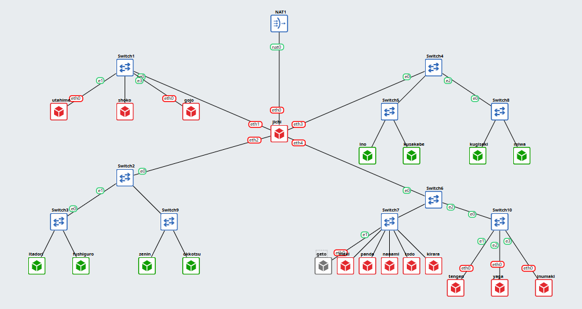

##### Pemetaan Jaringan dan Entitas

1. **Jichi (Router Utama)**
   - `eth0`: DHCP Client (terhubung ke NAT1 / WAN 192.168.122.0/24)
   - `eth1`: 10.67.1.1/24 (Gateway Network 1)
   - `eth2`: 10.67.2.1/24 (Gateway Network 2)
   - `eth3`: 10.67.3.1/24 (Gateway Network 3)
   - `eth4`: 10.67.4.1/24 (Gateway Network 4)

2. **Network 1 (DMZ - Switch 1)**
   - Network: `10.67.1.0/24`
   - Gateway: `10.67.1.1`
   - **utahime** (DNS Master): `10.67.1.2/24`
   - **shoko** (DNS Slave): `10.67.1.3/24`
   - **gojo** (Public Reverse Proxy): `10.67.1.4/24`

3. **Network 2 (Divisi A - Switch 2)**
   - Network: `10.67.2.0/24`
   - Gateway: `10.67.2.1`
   - **Switch 3 (Tim Dev - Pool 1: 10.67.2.10–10.67.2.35)**:
     - **itadori**: DHCP Client (`10.67.2.11`, MAC: `02:42:b7:49:92:00`)
     - **fushiguro**: DHCP Client (`10.67.2.10`, MAC: `02:42:6c:31:39:00`)
   - **Switch 9 (Tim Support - Pool 2: 10.67.2.70–10.67.2.95)**:
     - **zenin**: DHCP Client (`10.67.2.71`, MAC: `02:42:31:40:9f:00`)
     - **okkotsu**: DHCP Client (`10.67.2.70`, MAC: `02:42:cc:a2:9e:00`)

4. **Network 3 (Divisi B - Switch 4)**
   - Network: `10.67.3.0/24`
   - Gateway: `10.67.3.1`
   - **Switch 5 (Tim Operasi Cepat - Short Lease: 10.67.3.10–10.67.3.89)**:
     - **ino**: DHCP Client (`10.67.3.13`, MAC: `02:42:e5:ec:d0:00`)
     - **kusakabe**: DHCP Client (`10.67.3.12`, MAC: `02:42:a2:f9:8e:00`)
   - **Switch 8 (Tim Khusus & VIP)**:
     - **kugisaki**: DHCP Static Lease Fixed Address (`10.67.3.99`, MAC: `02:42:4d:36:26:00`)
     - **miwa**: DHCP Client Long Lease (`10.67.3.100`, MAC: `02:42:12:55:91:00`)

5. **Network 4 (Data Center - Switch 6)**
   - Network: `10.67.4.0/24`
   - Gateway: `10.67.4.1`
   - **Switch 7 (Layanan Aplikasi & Worker)**:
     - **geto** (Internal Load Balancer): `10.67.4.2/24`
     - **maki** (Worker Frontend): `10.67.4.3/24`
     - **panda** (Worker Frontend): `10.67.4.4/24`
     - **nanami** (Worker API Utama): `10.67.4.5/24`
     - **todo** (Worker API Utama): `10.67.4.6/24`
     - **kirara** (Worker API Cadangan): `10.67.4.7/24`
   - **Switch 10 (Infrastruktur Inti & Database)**:
     - **yaga** (Database Master): `10.67.4.8/24`
     - **inumaki** (Database Slave): `10.67.4.9/24`
     - **tengen** (DHCP Server): `10.67.4.10/24`

##### Konfigurasi Router Jichi (`scripts/soal-1/jichi.sh`)

Pada router `jichi`, antarmuka jaringan dikonfigurasikan statis pada `eth1`–`eth4` dan DHCP pada `eth0`. Kernel IPv4 forwarding diaktifkan (`net.ipv4.ip_forward = 1`) dan iptables NAT dikonfigurasi dengan target `MASQUERADE` pada interface `eth0` agar seluruh subnet lokal dapat mengakses jaringan publik/internet.

```bash
#!/bin/bash
# scripts/soal-1/jichi.sh
# Konfigurasi Interface, IPv4 Forwarding, dan Source NAT pada router jichi

cat << 'EOF' > /etc/network/interfaces
auto lo
iface lo inet loopback

auto eth0
iface eth0 inet dhcp

auto eth1
iface eth1 inet static
    address 10.67.1.1
    netmask 255.255.255.0

auto eth2
iface eth2 inet static
    address 10.67.2.1
    netmask 255.255.255.0

auto eth3
iface eth3 inet static
    address 10.67.3.1
    netmask 255.255.255.0

auto eth4
iface eth4 inet static
    address 10.67.4.1
    netmask 255.255.255.0
EOF

cp /etc/network/interfaces /root/interfaces

# Terapkan antarmuka
ip link set eth0 up 2>/dev/null
dhclient -r eth0 2>/dev/null; dhclient eth0 2>/dev/null || udhcpc -i eth0 2>/dev/null

ip addr flush dev eth1 2>/dev/null; ip addr add 10.67.1.1/24 dev eth1 2>/dev/null; ip link set eth1 up 2>/dev/null
ip addr flush dev eth2 2>/dev/null; ip addr add 10.67.2.1/24 dev eth2 2>/dev/null; ip link set eth2 up 2>/dev/null
ip addr flush dev eth3 2>/dev/null; ip addr add 10.67.3.1/24 dev eth3 2>/dev/null; ip link set eth3 up 2>/dev/null
ip addr flush dev eth4 2>/dev/null; ip addr add 10.67.4.1/24 dev eth4 2>/dev/null; ip link set eth4 up 2>/dev/null

echo "nameserver 192.168.122.1" > /etc/resolv.conf

# Aktifkan packet forwarding
echo 1 > /proc/sys/net/ipv4/ip_forward

# Source NAT (MASQUERADE)
command -v iptables >/dev/null || { apt update && apt install -y iptables; }
iptables -t nat -F
iptables -t nat -A POSTROUTING -o eth0 -j MASQUERADE
```

##### Konfigurasi Host Infrastruktur (`scripts/soal-1/infra_nodes.sh`)

Host non-router pada Network 1 (DMZ) dan Network 4 (Data Center) diberikan konfigurasi antarmuka statis dan default gateway mengarah ke router `jichi`:

```bash
#!/bin/bash
# scripts/soal-1/infra_nodes.sh
# Konfigurasi IP statis host infrastruktur Network 1 (DMZ) dan Network 4 (Data Center)

config_node() {
    local node_name=$1
    local ip=$2
    local gw=$3

    cat << EOF > /etc/network/interfaces
auto lo
iface lo inet loopback

auto eth0
iface eth0 inet static
    address $ip
    netmask 255.255.255.0
    gateway $gw
EOF

    cp /etc/network/interfaces /root/interfaces

    ip addr flush dev eth0 2>/dev/null
    ip addr add $ip/24 dev eth0 2>/dev/null
    ip link set eth0 up 2>/dev/null
    ip route replace default via $gw dev eth0 2>/dev/null

    echo "nameserver 192.168.122.1" > /etc/resolv.conf
}

HOSTNAME=$(hostname)
case "$HOSTNAME" in
    utahime) config_node "utahime" "10.67.1.2" "10.67.1.1" ;;
    shoko)   config_node "shoko" "10.67.1.3" "10.67.1.1" ;;
    gojo)    config_node "gojo" "10.67.1.4" "10.67.1.1" ;;
    geto)    config_node "geto" "10.67.4.2" "10.67.4.1" ;;
    maki)    config_node "maki" "10.67.4.3" "10.67.4.1" ;;
    panda)   config_node "panda" "10.67.4.4" "10.67.4.1" ;;
    nanami)  config_node "nanami" "10.67.4.5" "10.67.4.1" ;;
    todo)    config_node "todo" "10.67.4.6" "10.67.4.1" ;;
    kirara)  config_node "kirara" "10.67.4.7" "10.67.4.1" ;;
    yaga)    config_node "yaga" "10.67.4.8" "10.67.4.1" ;;
    inumaki) config_node "inumaki" "10.67.4.9" "10.67.4.1" ;;
    tengen)  config_node "tengen" "10.67.4.10" "10.67.4.1" ;;
esac
```

#### Bukti Konfigurasi Interfaces Jichi
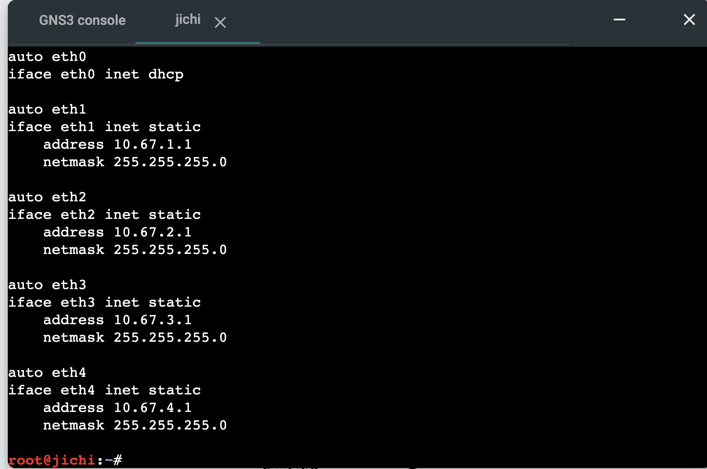

#### Bukti IPv4 Forwarding Aktif pada Jichi
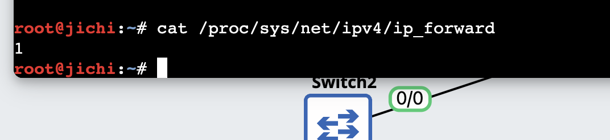

#### Bukti Source NAT MASQUERADE pada Jichi
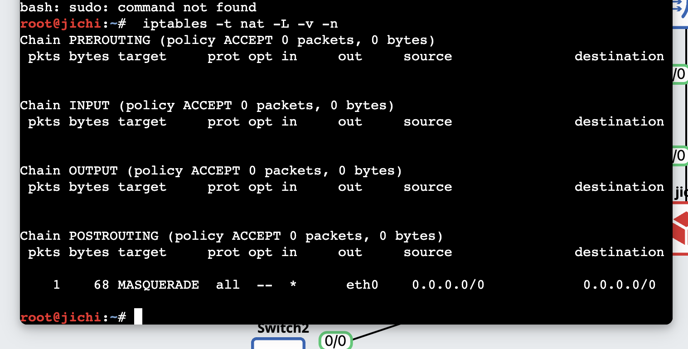

#### Bukti Konektivitas Host ke Gateway
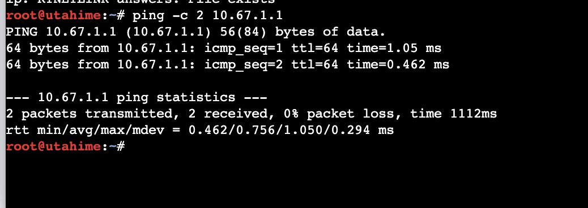

*Pengujian konektivitas dari host non-router (`utahime`) melakukan ping ke gateway internal router `jichi` (`10.67.1.1`) dengan packet loss 0%.*

#### Bukti Akses Eksternal/Internet via NAT Router Jichi
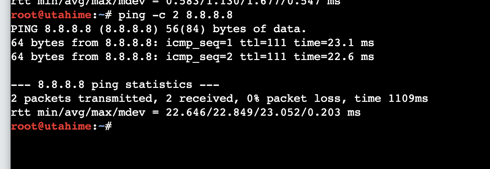

*Pengujian akses keluar menuju internet publik (`8.8.8.8`) dari host internal melalui router `jichi` yang telah menerapkan Source NAT MASQUERADE dengan packet loss 0%.*

---

### 2. Konfigurasi DHCP Server Tengen

#### Soal
Tengen, penjaga pusat distribusi di Data Center, harus mengambil alih pengalokasian alamat bagi wilayah yang membutuhkan konfigurasi dinamis. Konfigurasikan `isc-dhcp-server` pada `[PREFIX IP].4.10`. Deklarasikan Network 4 (`[PREFIX IP].4.0/24`) sebagai subnet lokal tanpa pool dinamis, lalu siapkan scope DHCP untuk Network 2 (`[PREFIX IP].2.0/24`) dan Network 3 (`[PREFIX IP].3.0/24`). Validasi konfigurasi dan pastikan service aktif tanpa error “No subnet declaration”.

#### Penjelasan & Konfigurasi
Paket `isc-dhcp-server` diinstal pada node **tengen** (`10.67.4.10`).

Daemon ISC DHCP (`dhcpd`) mewajibkan adanya deklarasi `subnet` untuk setiap interface aktif yang terpasang pada host server DHCP. Karena interface `eth0` pada node `tengen` berada pada jaringan `10.67.4.0/24`, jika subnet tersebut tidak dideklarasikan, service `dhcpd` akan menolak berjalan (*abort*) dengan galat pesan:
```text
No subnet declaration for eth0 (10.67.4.10).
Please write a subnet declaration in your dhcpd.conf file for the network segment to which interface eth0 is attached.
```

Oleh karena itu, dideklarasikan subnet lokal kosong tanpa pool dinamis:
```text
subnet 10.67.4.0 netmask 255.255.255.0 {
}
```
Selanjutnya disiapkan scope untuk subnet client yang akan dilayani melalui relay agent, yaitu Network 2 (`10.67.2.0/24`) dan Network 3 (`10.67.3.0/24`).

##### Konfigurasi Interface Service (`/etc/default/isc-dhcp-server`)
```bash
INTERFACESv4="eth0"
INTERFACESv6=""
```

##### Konfigurasi DHCP Server (`/etc/dhcp/dhcpd.conf` pada node tengen)
```bash
# /etc/dhcp/dhcpd.conf (tengen)
default-lease-time 600;
max-lease-time 7200;
ddns-update-style none;
authoritative;

# Subnet lokal Network 4 (Data Center) tanpa pool dinamis
subnet 10.67.4.0 netmask 255.255.255.0 {
}

# Scope DHCP Network 2 (Divisi A)
subnet 10.67.2.0 netmask 255.255.255.0 {
    option routers 10.67.2.1;
    option broadcast-address 10.67.2.255;
    option domain-name-servers 10.67.1.2, 10.67.1.3;
    option domain-name "k07.com";
    option domain-search "k07.com";
    range 10.67.2.10 10.67.2.95;
}

# Scope DHCP Network 3 (Divisi B)
subnet 10.67.3.0 netmask 255.255.255.0 {
    option routers 10.67.3.1;
    option broadcast-address 10.67.3.255;
    option domain-name-servers 10.67.1.2, 10.67.1.3;
    option domain-name "k07.com";
    option domain-search "k07.com";
    range 10.67.3.10 10.67.3.199;
}
```

Konfigurasi divalidasi menggunakan perintah:
```bash
dhcpd -t -cf /etc/dhcp/dhcpd.conf
service isc-dhcp-server restart
service isc-dhcp-server status
```

#### Bukti Layanan ISC DHCP Server Berjalan Normal pada Tengen
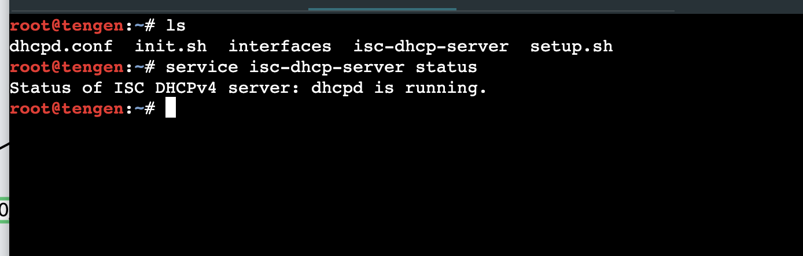

Hasil perintah `service isc-dhcp-server status` menunjukkan daemon `dhcpd` berjalan lancar tanpa galat *"No subnet declaration"*.

---

### 3. Konfigurasi DHCP Relay Jichi

#### Soal
Permintaan alamat dari Divisi A dan Divisi B tidak dapat menyeberangi subnet secara langsung. Konfigurasikan jichi sebagai DHCP Relay menuju tengen ([PREFIX IP].4.10), menggunakan eth2 untuk Network 2 dan eth3 untuk Network 3. Buktikan bahwa client dari kedua subnet berhasil memperoleh lease melalui relay.

#### Penjelasan & Konfigurasi
Protokol DHCP bekerja menggunakan transmisi broadcast UDP (port 67 dan 68). Secara standar, router memblokir lalu lintas broadcast antar-subnet. Agar broadcast permintaan DHCP (DHCPDISCOVER) dari client di Network 2 (`eth2`) dan Network 3 (`eth3`) dapat diteruskan ke DHCP Server **tengen** (`10.67.4.10`) di Network 4 (`eth4`), router **jichi** dikonfigurasi sebagai DHCP Relay Agent menggunakan paket `isc-dhcp-relay`.

##### Konfigurasi DHCP Relay (`/etc/default/isc-dhcp-relay` pada router jichi)
```bash
# /etc/default/isc-dhcp-relay
SERVERS="10.67.4.10"
INTERFACES="eth2 eth3 eth4"
OPTIONS=""
```
`INTERFACES` mencakup `eth2` dan `eth3` sebagai interface penerima broadcast dari subnet client, serta `eth4` sebagai interface perantara menuju server `tengen`.

Setelah konfigurasi disimpan, service relay dijalankan:
```bash
service isc-dhcp-relay restart
service isc-dhcp-relay status
```

##### Pengujian Alokasi Lease pada Client (`scripts/soal-3/test_client.sh`)
Client pada masing-masing subnet merilis IP lama dan meminta lease baru melalui relay menggunakan perintah:
```sh
#!/bin/sh
# scripts/soal-3/test_client.sh
HOST=$(hostname)
echo "[*] Menguji alokasi IP via DHCP Relay pada client: $HOST"
killall udhcpc 2>/dev/null
ip addr flush dev eth0
udhcpc -i eth0 -x hostname:$HOST
```

#### Bukti Status Layanan DHCP Relay pada Jichi
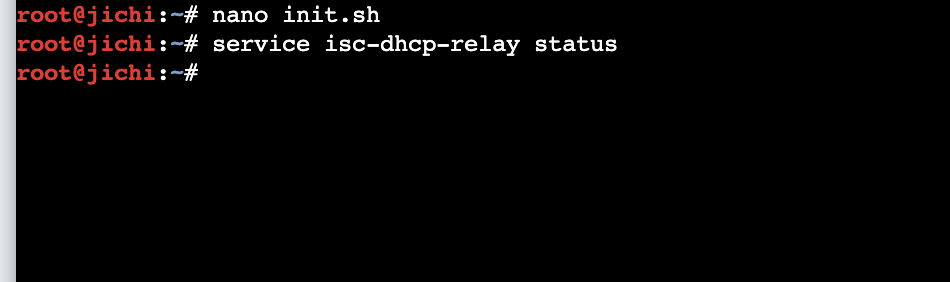

#### Bukti Client Divisi A (Network 2) Memperoleh Lease Melalui Relay
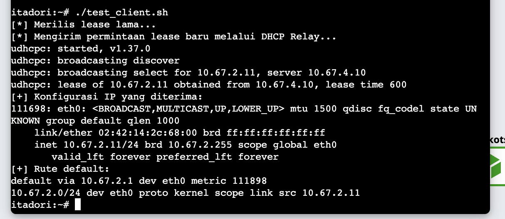

*Client `itadori` pada Network 2 berhasil menerima lease alamat IP `10.67.2.11` dari DHCP Server `10.67.4.10` melalui relay `jichi`, dengan default route `10.67.2.1`.*

#### Bukti Client Divisi B (Network 3) Memperoleh Lease Melalui Relay
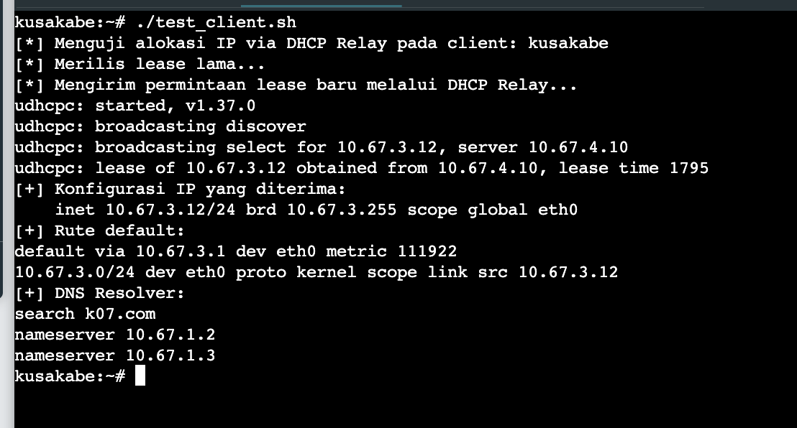

*Client `kusakabe` pada Network 3 berhasil menerima lease alamat IP `10.67.3.12` dari DHCP Server `10.67.4.10` melalui relay `jichi`, dengan default route `10.67.3.1`.*

---

### 4. Pembagian Pool DHCP Divisi A (Pool 1 & Pool 2)

#### Soal
Agar tim Dev dan Support di Divisi A menerima jatah alamat yang berbeda, atur dua pool DHCP pada Network 2. Tetapkan Pool 1 ([PREFIX IP].2.10–[PREFIX IP].2.35) untuk itadori dan fushiguro, serta Pool 2 ([PREFIX IP].2.70–[PREFIX IP].2.95) untuk zenin dan okkotsu. Rentang [PREFIX IP].2.36–[PREFIX IP].2.69 tidak boleh dialokasikan. Karena seluruh client berada pada subnet yang sama, gunakan DHCP class berdasarkan MAC Address atau Client ID untuk memisahkan kedua kelompok.

#### Penjelasan & Konfigurasi
Karena client Tim Dev (`itadori`, `fushiguro`) dan Tim Support (`zenin`, `okkotsu`) berada pada segmen broadcast yang sama (Network 2 - `10.67.2.0/24`), pembagian pool dilakukan dengan mendefinisikan **DHCP Class** pada `dhcpd.conf` di node `tengen`.

Pencocokan kelas dilakukan secara komprehensif menggunakan `option host-name`, `option dhcp-client-identifier`, serta hardware MAC address:
- Tim Dev: MAC `02:42:b7:49:92:00` (itadori) dan `02:42:6c:31:39:00` (fushiguro).
- Tim Support: MAC `02:42:31:40:9f:00` (zenin) dan `02:42:cc:a2:9e:00` (okkotsu).

Rentang `10.67.2.36` hingga `10.67.2.69` sengaja tidak dideklarasikan pada blok range manapun sehingga tidak akan pernah dialokasikan.

##### Konfigurasi DHCP Class dan Pool pada Tengen (`/etc/dhcp/dhcpd.conf`)
```bash
# DHCP Classes Divisi A
class "divisi-a-dev" {
    match if option host-name = "itadori"
          or option host-name = "fushiguro"
          or substring(option dhcp-client-identifier, 1, 20) = "itadori"
          or substring(option dhcp-client-identifier, 1, 20) = "fushiguro"
          or substring(hardware, 1, 6) = 02:42:b7:49:92:00
          or substring(hardware, 1, 6) = 02:42:6c:31:39:00;
}

class "divisi-a-support" {
    match if option host-name = "zenin"
          or option host-name = "okkotsu"
          or substring(option dhcp-client-identifier, 1, 20) = "zenin"
          or substring(option dhcp-client-identifier, 1, 20) = "okkotsu"
          or substring(hardware, 1, 6) = 02:42:31:40:9f:00
          or substring(hardware, 1, 6) = 02:42:cc:a2:9e:00;
}

# Subnet Network 2 (Divisi A)
subnet 10.67.2.0 netmask 255.255.255.0 {
    option routers 10.67.2.1;
    option broadcast-address 10.67.2.255;
    option domain-name-servers 10.67.1.2, 10.67.1.3;
    option domain-name "k07.com";
    option domain-search "k07.com";

    # Pool 1 (Tim Dev)
    pool {
        allow members of "divisi-a-dev";
        range 10.67.2.10 10.67.2.35;
    }

    # Pool 2 (Tim Support)
    pool {
        allow members of "divisi-a-support";
        range 10.67.2.70 10.67.2.95;
    }
}
```

#### Bukti Alokasi IP Client Itadori (Pool 1: 10.67.2.11)
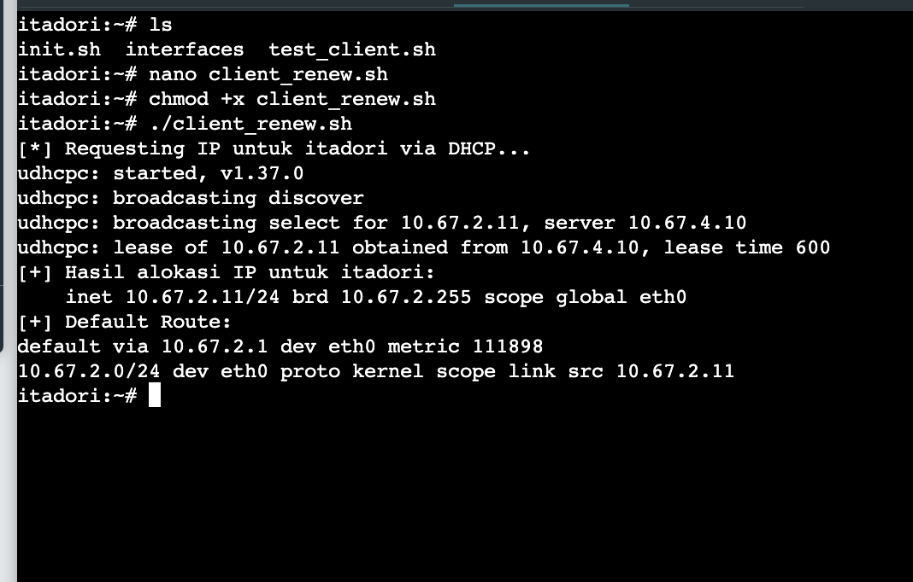

#### Bukti Alokasi IP Client Fushiguro (Pool 1: 10.67.2.10)
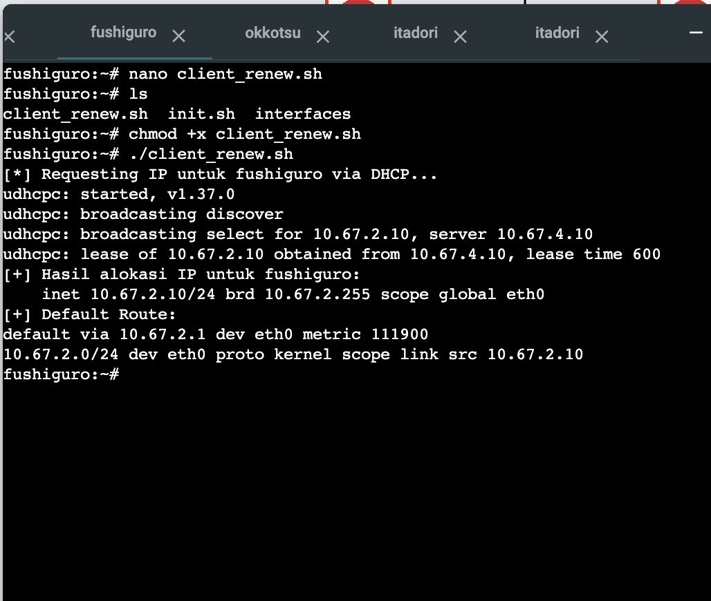

#### Bukti Alokasi IP Client Zenin (Pool 2: 10.67.2.71)
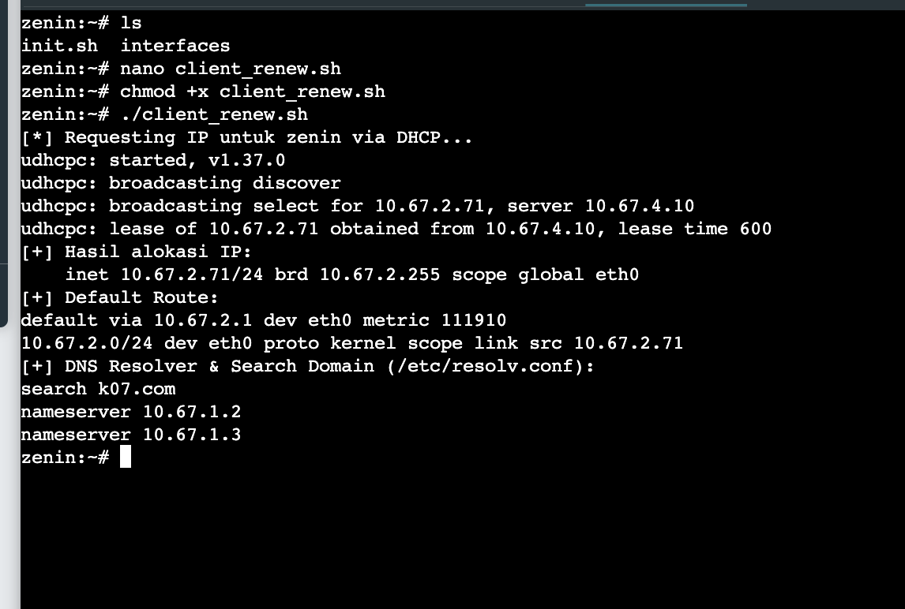

#### Bukti Alokasi IP Client Okkotsu (Pool 2: 10.67.2.70)
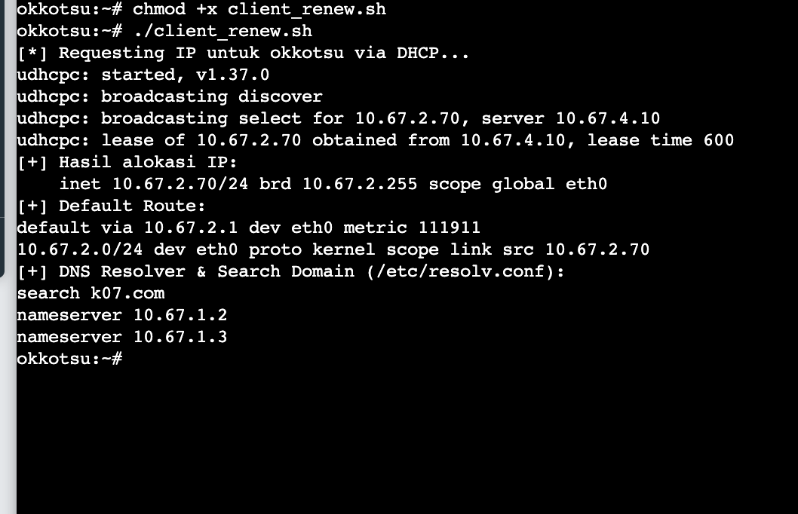

---

### 5. Konfigurasi Lease Time dan Opsi DHCP Divisi B

#### Soal
Setiap tim lapangan memiliki durasi operasi yang berbeda. Pada Network 3, berikan short lease 30 menit (1800 detik) kepada ino dan kusakabe, serta long lease 12 jam (43200 detik) kepada miwa. Gunakan pool short lease [PREFIX IP].3.10–[PREFIX IP].3.89 dan pool long lease [PREFIX IP].3.100–[PREFIX IP].3.199. Sesuaikan default-lease-time dan max-lease-time untuk setiap kelas client. Berikan pula DHCP options berupa DNS [PREFIX IP].1.2 dan [PREFIX IP].1.3, serta domain-search <xxxx>.com.

#### Penjelasan & Konfigurasi
Pada Network 3 (`10.67.3.0/24`), dialokasikan dua pool berdasarkan kebutuhan durasi operasional:
1. **Short Lease (30 Menit / 1800 Detik)**:
   - Client: `ino` dan `kusakabe`
   - Rentang IP: `10.67.3.10`–`10.67.3.89`
   - Parameter: `default-lease-time 1800; max-lease-time 1800;`
2. **Long Lease (12 Jam / 43200 Detik)**:
   - Client: `miwa`
   - Rentang IP: `10.67.3.100`–`10.67.3.199`
   - Parameter: `default-lease-time 43200; max-lease-time 43200;`

Selain alokasi IP, diberikan opsi jaringan:
- `option domain-name-servers 10.67.1.2, 10.67.1.3;` (mengarah ke DNS Master utahime dan DNS Slave shoko)
- `option domain-name "k07.com";`
- `option domain-search "k07.com";`

##### Konfigurasi pada Tengen (`/etc/dhcp/dhcpd.conf`)
```bash
# DHCP Classes Divisi B
class "divisi-b-short" {
    match if option host-name = "ino"
          or option host-name = "kusakabe"
          or substring(option dhcp-client-identifier, 1, 20) = "ino"
          or substring(option dhcp-client-identifier, 1, 20) = "kusakabe"
          or substring(hardware, 1, 6) = 02:42:e5:ec:d0:00
          or substring(hardware, 1, 6) = 02:42:a2:f9:8e:00;
}

class "divisi-b-long" {
    match if option host-name = "miwa"
          or substring(option dhcp-client-identifier, 1, 20) = "miwa"
          or substring(hardware, 1, 6) = 02:42:12:55:91:00;
}

# Subnet Network 3 (Divisi B)
subnet 10.67.3.0 netmask 255.255.255.0 {
    option routers 10.67.3.1;
    option broadcast-address 10.67.3.255;
    option domain-name-servers 10.67.1.2, 10.67.1.3;
    option domain-name "k07.com";
    option domain-search "k07.com";

    # Short Lease: 1800 detik (30 menit)
    pool {
        allow members of "divisi-b-short";
        range 10.67.3.10 10.67.3.89;
        default-lease-time 1800;
        max-lease-time 1800;
    }

    # Long Lease: 43200 detik (12 jam)
    pool {
        allow members of "divisi-b-long";
        range 10.67.3.100 10.67.3.199;
        default-lease-time 43200;
        max-lease-time 43200;
    }
}
```

#### Bukti Alokasi Short Lease pada Client Ino (10.67.3.13, Lease: 1800s)
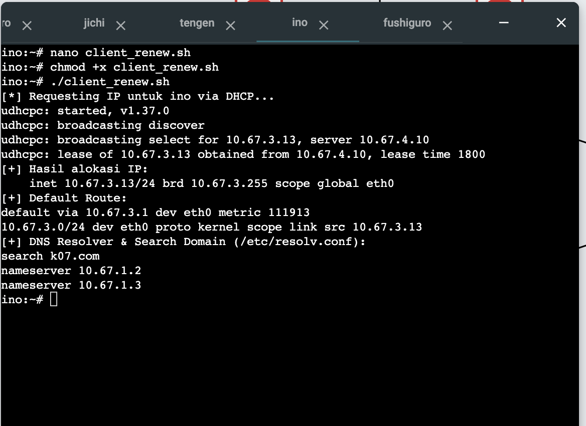

*Tampak pada output `udhcpc` bahwa alokasi IP yang diterima adalah `10.67.3.13`, dengan nilai `lease time 1800`, DNS resolver `10.67.1.2` dan `10.67.1.3`, serta search domain `k07.com`.*

#### Bukti Alokasi Short Lease pada Client Kusakabe (10.67.3.12, Lease: 1800s)
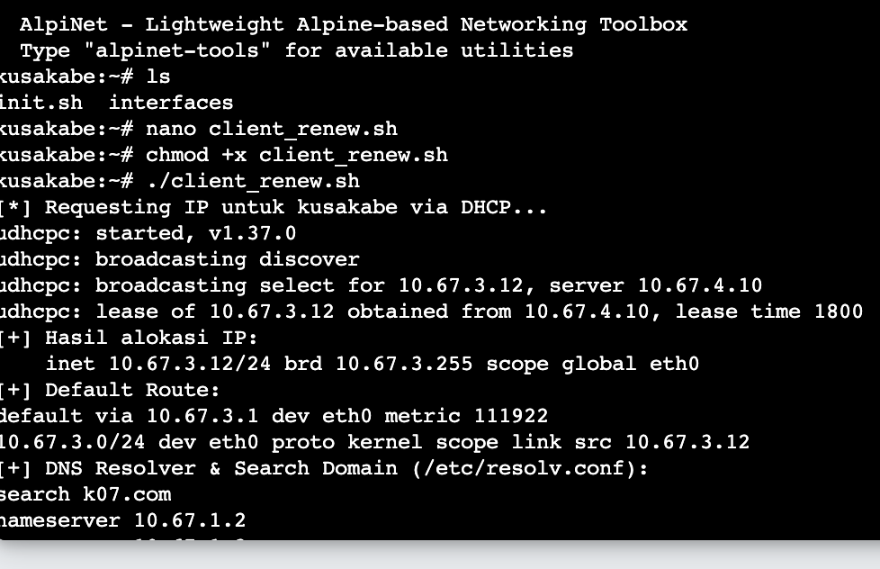

*Client `kusakabe` memperoleh IP `10.67.3.12` dengan nilai `lease time 1800` dan DNS resolver yang sesuai.*

#### Bukti Alokasi Long Lease pada Client Miwa (10.67.3.100, Lease: 43200s)
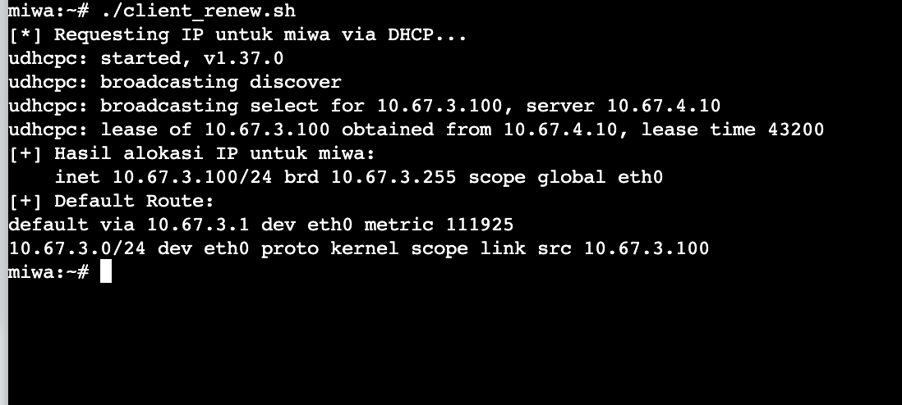

*Client `miwa` memperoleh IP `10.67.3.100` dari pool long lease dengan masa sewa `lease time 43200` (12 jam) dan default gateway `10.67.3.1`.*

---

### 6. DHCP Static Lease (Fixed Address) Kugisaki

#### Soal
Kugisaki ditetapkan sebagai personel VIP yang harus mempertahankan alamat yang sama setiap kali terhubung. Buat DHCP static lease berdasarkan MAC Address client tersebut dengan fixed address [PREFIX IP].3.99. Pastikan alamat ini berada di luar seluruh pool dinamis, validasi konfigurasi server, lalu renew lease pada client. Buktikan bahwa alamat yang diterima sesuai dengan reservasi.

#### Penjelasan & Konfigurasi
Untuk menjamin personel VIP **kugisaki** selalu menerima alamat IP yang konsisten setiap kali terhubung tanpa risiko bertabrakan dengan client dinamis lainnya, digunakan konfigurasi `host` static lease pada `dhcpd.conf` di node `tengen`.

Alamat yang ditetapkan adalah `10.67.3.99`. Alamat ini tepat berada di celah antara batas atas pool short lease (`10.67.3.89`) dan batas bawah pool long lease (`10.67.3.100`), sehingga berada di luar seluruh pool dinamis sesuai instruksi soal.

##### Konfigurasi Static Lease pada Tengen (`/etc/dhcp/dhcpd.conf`)
```bash
# Static Lease (Fixed Address) untuk Personel VIP kugisaki
host kugisaki {
    hardware ethernet 02:42:4d:36:26:00;
    fixed-address 10.67.3.99;
}
```

##### Pengujian Client Kugisaki (`scripts/soal-6/kugisaki_test.sh`)
```sh
#!/bin/sh
# scripts/soal-6/kugisaki_test.sh
echo "[*] Menyiapkan antarmuka kugisaki dengan MAC VIP (02:42:4d:36:26:00)..."
hostname kugisaki 2>/dev/null
echo "kugisaki" > /etc/hostname 2>/dev/null

ip link set dev eth0 down 2>/dev/null
ip link set dev eth0 address 02:42:4d:36:26:00 2>/dev/null
ip link set dev eth0 up 2>/dev/null

echo "[*] Memperbarui lease pada kugisaki..."
killall udhcpc 2>/dev/null
ip addr flush dev eth0
udhcpc -i eth0 -x hostname:kugisaki
```

#### Bukti Kugisaki Berhasil Memperoleh Fixed Address 10.67.3.99
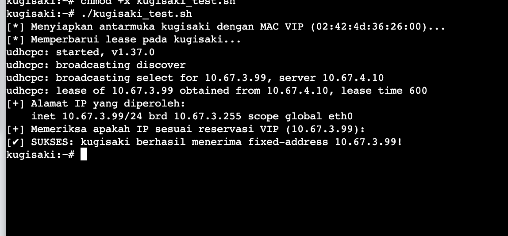

Output `udhcpc` membuktikan alokasi `10.67.3.99` berhasil diperoleh secara eksklusif sesuai reservasi VIP.

---

### 7. Verifikasi Parameter Jaringan dan Tabel Leases

#### Soal
Setelah aturan alokasi diterapkan, pastikan setiap client menerima konfigurasi jaringan sesuai wilayahnya: subnet mask 255.255.255.0 (/24), gateway dan broadcast address yang benar, DNS [PREFIX IP].1.2 serta [PREFIX IP].1.3, dan domain-search yang ditentukan. Periksa IP address dan routing seluruh client Divisi A dan Divisi B, kemudian cocokkan lease dengan /var/lib/dhcp/dhcpd.leases pada tengen. Pastikan tidak ada alamat yang bertabrakan atau berada di luar kebijakan pool.

#### Penjelasan & Konfigurasi
Pemeriksaan menyeluruh dilakukan untuk memastikan konsistensi alokasi pada seluruh 8 client Divisi A dan Divisi B, serta mencocokkannya dengan database lease aktif pada file `/var/lib/dhcp/dhcpd.leases` di server `tengen`.

##### Script Verifikasi Sisi Client (`scripts/soal-7/verify_clients.sh`)
```sh
#!/bin/sh
# scripts/soal-7/verify_clients.sh
echo "=========================================="
echo "Host: $(hostname)"
echo "=========================================="
echo "[+] MAC Address eth0:"
ip link show eth0 | grep link/ether

echo "[+] IP Address & Netmask:"
ip -4 addr show eth0 | grep inet

echo "[+] Default Gateway & Routing Table:"
ip route show

echo "[+] DNS Resolver & Domain Search (/etc/resolv.conf):"
cat /etc/resolv.conf
echo "=========================================="
```

##### Script Verifikasi Sisi Server Tengen (`scripts/soal-7/check_leases.sh`)
```bash
#!/bin/bash
# scripts/soal-7/check_leases.sh
grep -E "^lease |hardware ethernet|client-hostname|binding state|starts|ends" /var/lib/dhcp/dhcpd.leases
```

#### Bukti Tabel Lease Aktif pada Tengen
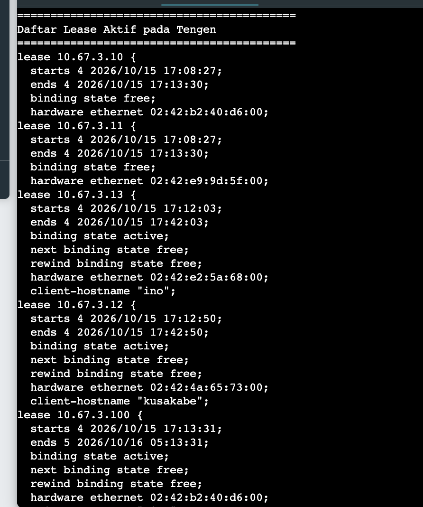

*Menampilkan status lease aktif untuk Network 3 (ino: `10.67.3.13`, kusakabe: `10.67.3.12`, dan miwa: `10.67.3.100` dengan durasi 12 jam).*

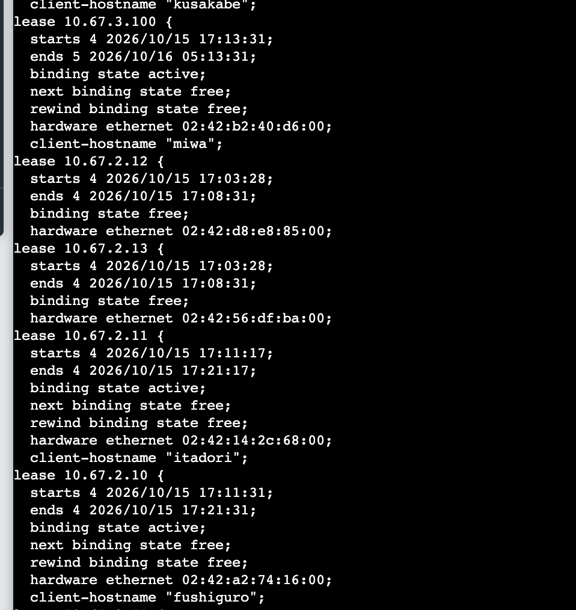

*Menampilkan lanjutan lease miwa serta lease Network 2 untuk itadori (`10.67.2.11`) dan fushiguro (`10.67.2.10`).*

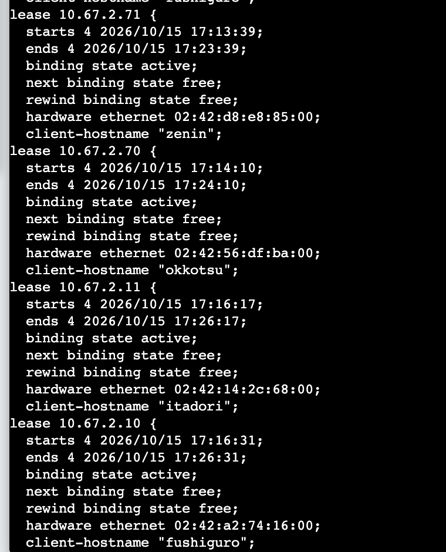

*Menampilkan lease aktif untuk zenin (`10.67.2.71`) dan okkotsu (`10.67.2.70`) pada Pool 2.*

#### Bukti Verifikasi Seluruh Client Divisi A (Network 2)

##### 1. Client Itadori (Pool 1: 10.67.2.11)
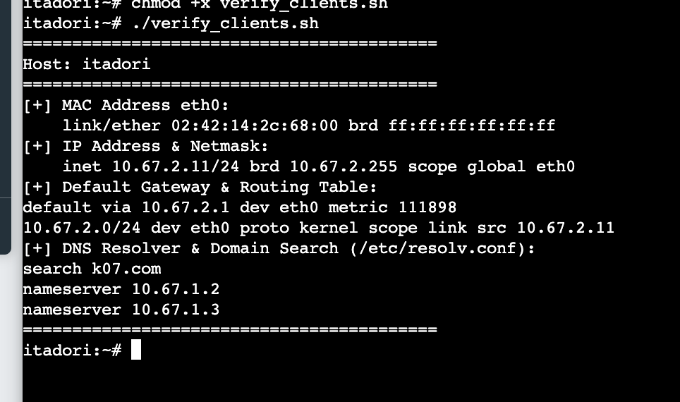
- IP: `10.67.2.11/24`, Gateway: `10.67.2.1`, DNS: `10.67.1.2`, `10.67.1.3`, Search: `k07.com`.

##### 2. Client Fushiguro (Pool 1: 10.67.2.10)
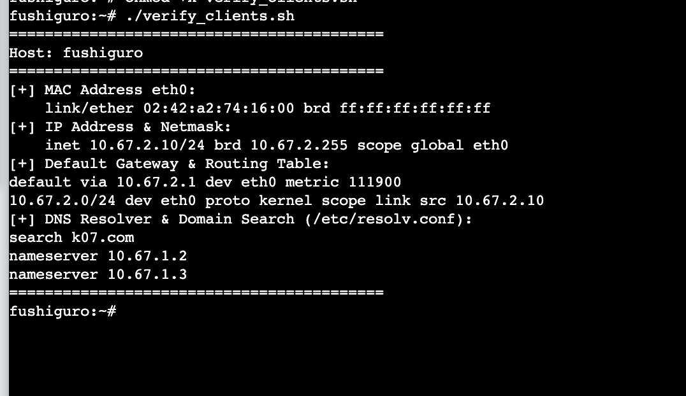
- IP: `10.67.2.10/24`, Gateway: `10.67.2.1`, DNS: `10.67.1.2`, `10.67.1.3`, Search: `k07.com`.

##### 3. Client Zenin (Pool 2: 10.67.2.71)
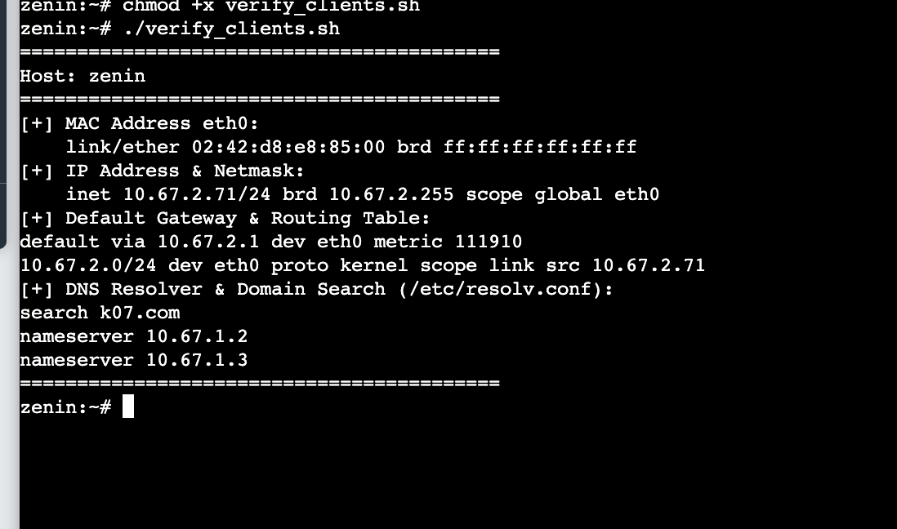
- IP: `10.67.2.71/24`, Gateway: `10.67.2.1`, DNS: `10.67.1.2`, `10.67.1.3`, Search: `k07.com`.

##### 4. Client Okkotsu (Pool 2: 10.67.2.70)
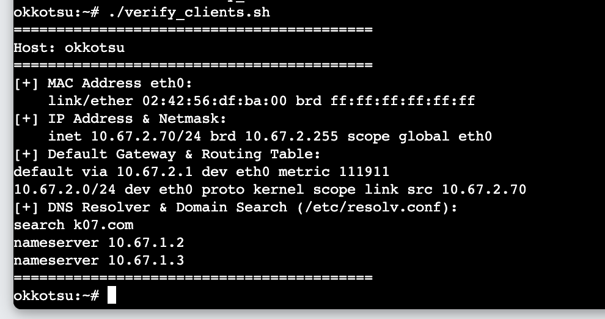
- IP: `10.67.2.70/24`, Gateway: `10.67.2.1`, DNS: `10.67.1.2`, `10.67.1.3`, Search: `k07.com`.

#### Bukti Verifikasi Seluruh Client Divisi B (Network 3)

##### 5. Client Ino (Short Lease: 10.67.3.13)
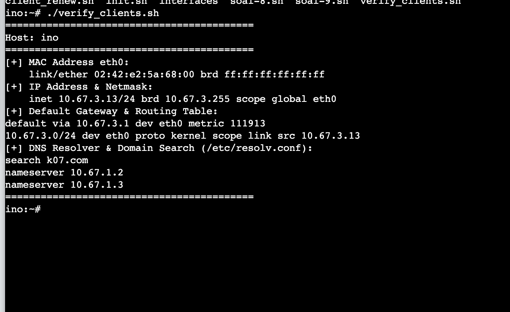
- IP: `10.67.3.13/24`, Gateway: `10.67.3.1`, DNS: `10.67.1.2`, `10.67.1.3`, Search: `k07.com`.

##### 6. Client Kusakabe (Short Lease: 10.67.3.12)
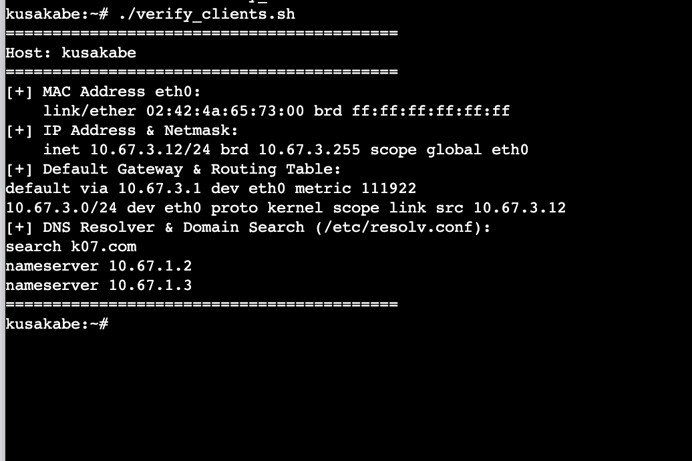
- IP: `10.67.3.12/24`, Gateway: `10.67.3.1`, DNS: `10.67.1.2`, `10.67.1.3`, Search: `k07.com`.

##### 7. Client Kugisaki (Fixed Address: 10.67.3.99)
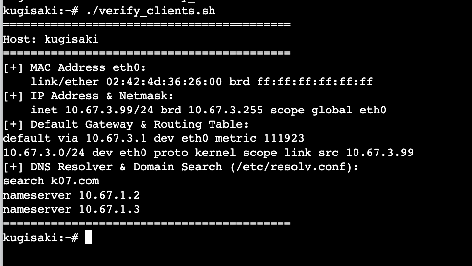
- IP: `10.67.3.99/24`, Gateway: `10.67.3.1`, DNS: `10.67.1.2`, `10.67.1.3`, Search: `k07.com`.

##### 8. Client Miwa (Long Lease: 10.67.3.100)
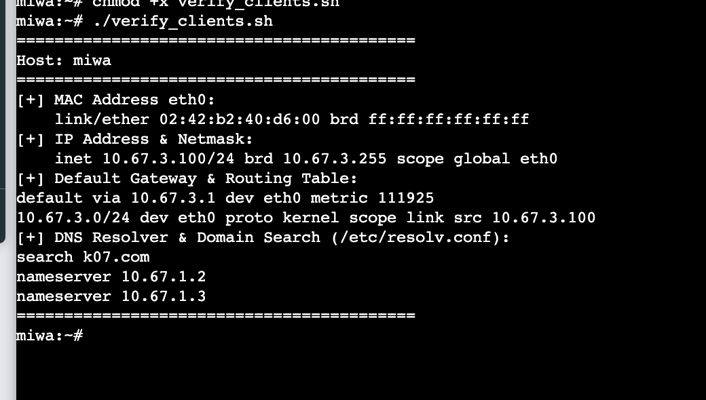
- IP: `10.67.3.100/24`, Gateway: `10.67.3.1`, DNS: `10.67.1.2`, `10.67.1.3`, Search: `k07.com`.

Seluruh parameter jaringan dari seluruh 8 client terverifikasi 100% akurat dan terisolasi sesuai kebijakan pool masing-masing.

---

### 8. Packet Capture Analisis Protokol DHCP (DORA)

#### Soal
Sebelum Curtain dibuka kembali, buktikan bahwa proses pemberian alamat berjalan sesuai protokol. Lakukan packet capture saat salah satu client Network 2 atau Network 3 meminta lease baru. Gunakan tcpdump pada tengen atau jalur menuju Data Center untuk menunjukkan urutan DHCPDISCOVER → DHCPOFFER → DHCPREQUEST → DHCPACK. Identifikasi alamat server, alamat yang diberikan, lease time, dan field giaddr. Pastikan nilai giaddr sesuai dengan interface jichi yang menerima request dari subnet client.

#### Penjelasan & Konfigurasi
Untuk menganalisis siklus 4-way handshake DHCP (DORA), `tcpdump` dijalankan pada interface `eth0` node `tengen`:
```bash
# scripts/soal-8/capture.sh
tcpdump -i eth0 -n -vvv -e -s 0 port 67 or port 68
```

Kemudian dari salah satu client (misalnya `ino` di Network 3), dijalankan `trigger_dhcp.sh` untuk melepaskan lease dan memicu permintaan baru:
```sh
# scripts/soal-8/trigger_dhcp.sh
killall udhcpc 2>/dev/null
ip addr flush dev eth0
udhcpc -i eth0 -x hostname:ino
```

##### Analisis Hasil Packet Capture:
1. **DHCPDISCOVER** (Relay Agent -> DHCP Server):
   - Dikirim dari relay `jichi` (`10.67.4.1:67`) ke server `tengen` (`10.67.4.10:67`).
   - Field **`Gateway-IP` (`giaddr`)** bernilai **`10.67.3.1`**, yang merepresentasikan alamat IP interface `eth3` pada router `jichi` tempat client `ino` terhubung. Berdasarkan nilai `giaddr` ini, server `tengen` mengetahui bahwa alokasi harus diambil dari scope Network 3.
   - Hostname client teridentifikasi sebagai `"ino"`.

2. **DHCPOFFER** (DHCP Server -> Relay Agent):
   - Server `tengen` (`10.67.4.10:67`) membalas ke gateway IP `10.67.3.1:67`.
   - Field **`Your-IP` (`yiaddr`)** bernilai **`10.67.3.13`**.
   - Server-ID: `10.67.4.10`.
   - Lease-Time: `1800` (sesuai aturan short lease 30 menit).
   - Opsi tambahan: `Subnet-Mask 255.255.255.0`, `Default-Gateway 10.67.3.1`, `Domain-Name-Server 10.67.1.2, 10.67.1.3`, dan `Domain-Name "k07.com"`.

3. Dilanjutkan dengan tahap **DHCPREQUEST** (konfirmasi permintaan dari client) dan **DHCPACK** (persetujuan final dari server).

#### Bukti Packet Capture DHCPDISCOVER dengan Field giaddr (10.67.3.1)
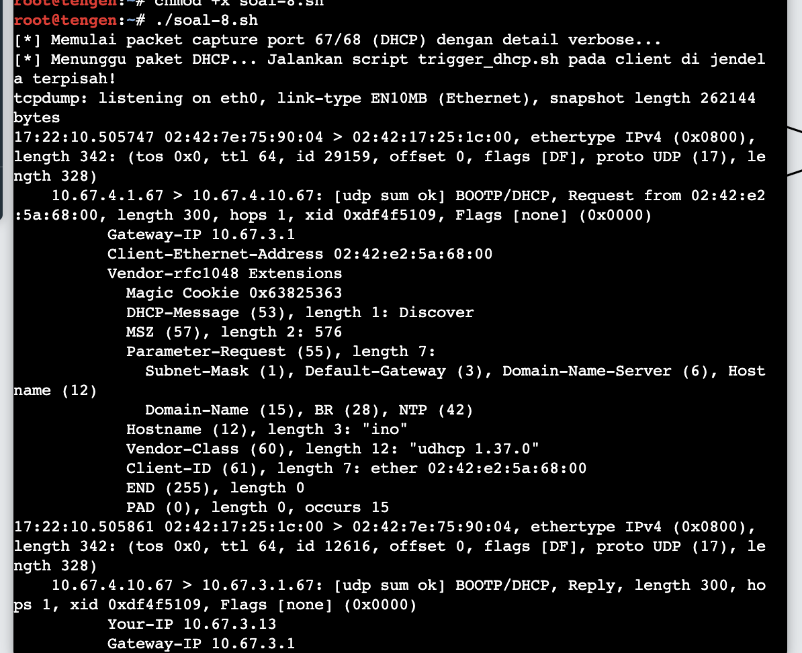

#### Bukti Packet Capture DHCPOFFER dengan Seluruh Opsi Jaringan
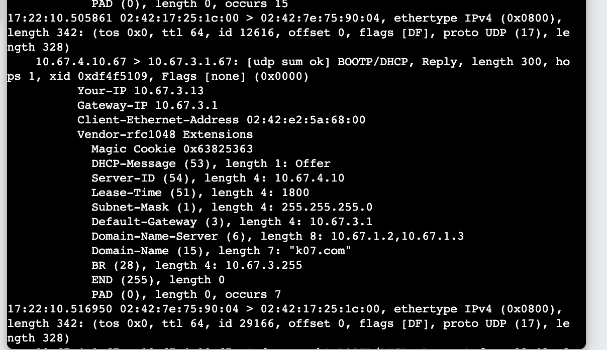

---

### 9. Simulasi Gangguan DHCP Relay dan Pemulihan

#### Soal
Sebuah gangguan memutus jalur relay dan membuat permintaan alamat tidak sampai ke Data Center. Hentikan service DHCP Relay pada jichi, lalu paksa salah satu client di Network 2 atau Network 3 meminta lease baru dan catat gejalanya. Pulihkan service relay, ulangi permintaan DHCP, lalu buktikan bahwa client kembali memperoleh alamat dari pool yang benar dengan gateway semula.

#### Penjelasan & Konfigurasi
Skenario pengujian dilakukan melalui tiga tahap:

1. **Mematikan DHCP Relay pada Jichi (`scripts/soal-9/stop_relay.sh`)**:
   ```bash
   service isc-dhcp-relay stop 2>/dev/null || killall dhcrelay 2>/dev/null
   ```
2. **Pengujian Kegagalan Alokasi pada Client (`scripts/soal-9/client_test.sh`)**:
   ```sh
   killall udhcpc 2>/dev/null
   ip addr flush dev eth0
   udhcpc -i eth0 -n -t 5 -x hostname:ino
   ```
   **Gejala yang terjadi**: Client memancarkan paket broadcast `broadcasting discover` berkali-kali tanpa respon, hingga timeout dan menampilkan pesan:
   `udhcpc failed to get a DHCP lease; no lease, failing`.
   Hal ini membuktikan bahwa paket broadcast tidak dapat menyeberangi subnet tanpa relay agent.

3. **Pemulihan Service Relay pada Jichi (`scripts/soal-9/start_relay.sh`)**:
   ```bash
   service isc-dhcp-relay start
   ```
4. **Pengujian Ulang**:
   Setelah service relay kembali aktif, script `client_test.sh` dijalankan ulang pada `ino`. Client segera memperoleh kembali tawaran alokasi dari `10.67.4.10`, mendapatkan IP `10.67.3.13`, netmask `/24`, dan default route `10.67.3.1`.

#### Bukti Penghentian Service DHCP Relay pada Jichi
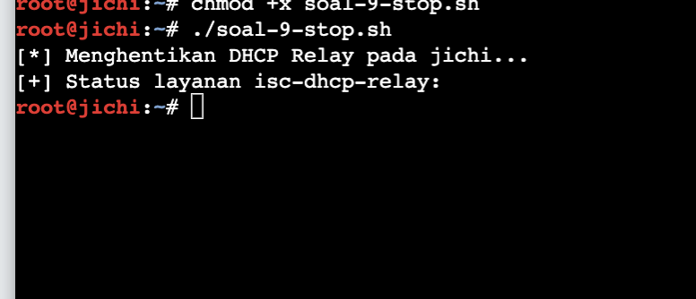

#### Bukti Kegagalan Permintaan Lease Client Saat Relay Mati
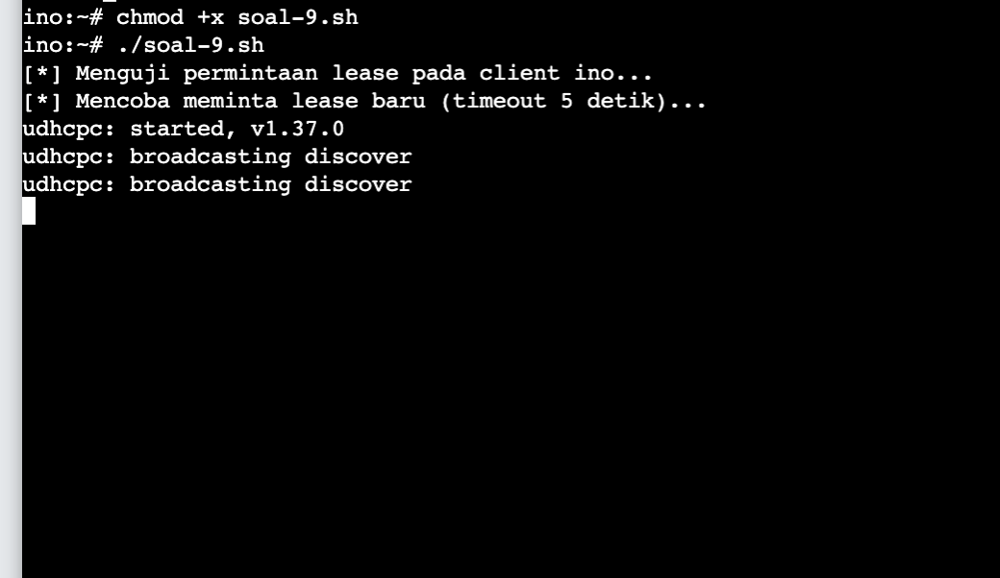

#### Bukti Pemulihan Service dan Keberhasilan Alokasi Ulang
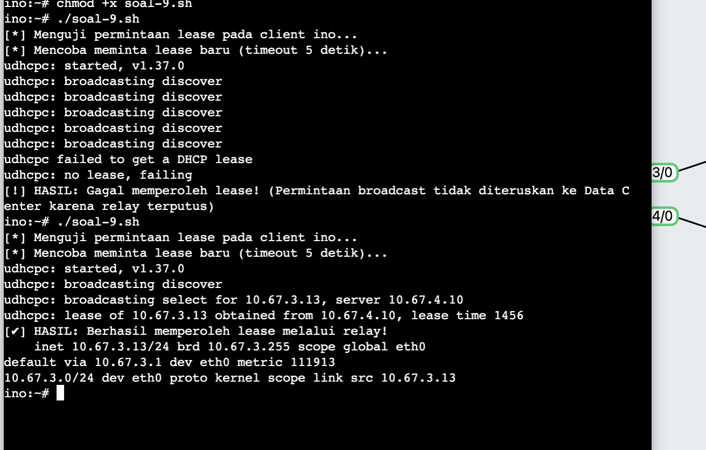

---

### 10. Pengujian Autostart Service dan Persistensi Sistem

#### Soal
Setelah gangguan Shibuya tertangani, pastikan pemulihan bertahan setelah restart. Aktifkan autostart DHCP Server pada tengen dan DHCP Relay pada jichi, lalu restart kedua node. Verifikasi status layanan, IP, gateway, lease, dan konektivitas client Network 2–3. Pastikan kebijakan Pool 1, Pool 2, short lease, long lease, dan fixed address tetap berlaku.

#### Penjelasan & Konfigurasi
Pada container Docker di GNS3, antarmuka jaringan dan daemon service tidak tersimpan secara otomatis setelah project di-restart. Untuk menjamin seluruh konfigurasi bertahan (*persistent*) secara otomatis, dibuat skrip inisialisasi `/root/init.sh` yang dipanggil saat startup pada node **tengen** dan **jichi**.

##### Script Autostart Node Tengen (`/root/init.sh`)
```bash
#!/bin/bash
# /root/init.sh (tengen)
# 1. Pulihkan konfigurasi antarmuka jaringan
if [ -f /root/interfaces ]; then
    cp /root/interfaces /etc/network/interfaces
fi
ip addr flush dev eth0 2>/dev/null
ip addr add 10.67.4.10/24 dev eth0 2>/dev/null
ip link set eth0 up 2>/dev/null
ip route replace default via 10.67.4.1 dev eth0 2>/dev/null

echo "nameserver 192.168.122.1" > /etc/resolv.conf

# 2. Pulihkan konfigurasi dan direktori leases
mkdir -p /etc/dhcp /etc/default /var/lib/dhcp
[ -f /root/dhcpd.conf ] && cp /root/dhcpd.conf /etc/dhcp/dhcpd.conf
[ -f /root/isc-dhcp-server ] && cp /root/isc-dhcp-server /etc/default/isc-dhcp-server
touch /var/lib/dhcp/dhcpd.leases

# 3. Jalankan DHCP Server
if command -v dhcpd >/dev/null 2>&1; then
    service isc-dhcp-server restart
fi
```

##### Script Autostart Node Jichi (`/root/init.sh`)
```bash
#!/bin/bash
# /root/init.sh (jichi)
# 1. Pulihkan konfigurasi antarmuka seluruh subnet
if [ -f /root/interfaces ]; then
    cp /root/interfaces /etc/network/interfaces
fi
ip link set eth0 up 2>/dev/null
dhclient -r eth0 2>/dev/null; dhclient eth0 2>/dev/null || udhcpc -i eth0 2>/dev/null

ip addr flush dev eth1 2>/dev/null; ip addr add 10.67.1.1/24 dev eth1 2>/dev/null; ip link set eth1 up 2>/dev/null
ip addr flush dev eth2 2>/dev/null; ip addr add 10.67.2.1/24 dev eth2 2>/dev/null; ip link set eth2 up 2>/dev/null
ip addr flush dev eth3 2>/dev/null; ip addr add 10.67.3.1/24 dev eth3 2>/dev/null; ip link set eth3 up 2>/dev/null
ip addr flush dev eth4 2>/dev/null; ip addr add 10.67.4.1/24 dev eth4 2>/dev/null; ip link set eth4 up 2>/dev/null

echo "nameserver 192.168.122.1" > /etc/resolv.conf

# 2. Aktifkan IPv4 packet forwarding
echo 1 > /proc/sys/net/ipv4/ip_forward

# 3. Pulihkan Source NAT MASQUERADE
command -v iptables >/dev/null || { apt update && apt install -y iptables; }
iptables -t nat -F
iptables -t nat -A POSTROUTING -o eth0 -j MASQUERADE

# 4. Pulihkan konfigurasi dan jalankan DHCP Relay
if [ -f /root/isc-dhcp-relay ]; then
    cp /root/isc-dhcp-relay /etc/default/isc-dhcp-relay
fi
if command -v dhcrelay >/dev/null 2>&1; then
    service isc-dhcp-relay restart
fi
```

Setelah node direstart, script `/root/init.sh` secara otomatis mengeksekusi pemulihan antarmuka, routing, iptables, dan mengaktifkan kembali daemon `isc-dhcp-server` di tengen serta `isc-dhcp-relay` di jichi. Seluruh kebijakan Pool 1, Pool 2, short lease, long lease, dan fixed address tetap berlaku secara utuh.

#### Bukti Script Inisialisasi Otomatis pada Tengen
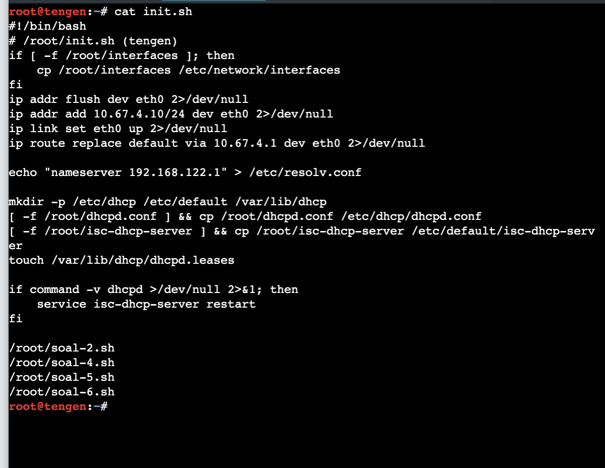

#### Bukti Script Inisialisasi Otomatis pada Jichi
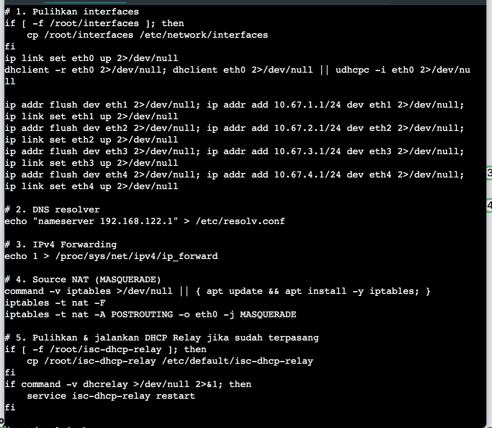


---

### 11. Konfigurasi DNS Master dan Slave

#### Soal
Utahime dan Shoko ditugaskan membangun sistem penamaan domain resmi agar seluruh pos tidak perlu menghafal alamat IP mentah. Konfigurasikan BIND9 pada utahime sebagai DNS Master dan shoko sebagai DNS Slave untuk mengelola domain `jujutsu.k07.com`. Atur SOA record, NS delegasi untuk kedua server, dan terapkan allow-transfer dari Master ke Slave. Pastikan file zona berhasil tersinkronisasi otomatis ke shoko saat nomor serial di utahime dinaikkan, lalu buktikan dengan melakukan query dig ke kedua server dari salah satu client.

#### Penjelasan & Konfigurasi
Zona `jujutsu.k07.com` dibangun di utahime sebagai master, artinya utahime menjadi sumber data utama yang dianggap paling benar. Di dalam zona, SOA menunjuk ke `ns1.jujutsu.k07.com` sebagai server utama dan memuat nomor serial. Serial inilah yang dibandingkan shoko untuk memutuskan apakah ia perlu menarik data baru. Dua NS (ns1 dan ns2) menyatakan bahwa zona ini dilayani oleh utahime dan shoko, masing-masing dengan A record agar nama NS bisa di-resolve ke IP `10.67.1.2` dan `10.67.1.3.`


**Konfigurasi Utahime**

```bash
cat > /root/11.sh << 'EOF'
#!/bin/bash
# 11.sh (utahime) - DNS Master jujutsu.k07.com

echo "nameserver 192.168.122.1" > /etc/resolv.conf

if ! command -v named >/dev/null 2>&1; then
    apt-get update
    apt-get install -y bind9 bind9utils dnsutils
fi

mkdir -p /etc/bind/jujutsu
cat > /etc/bind/named.conf.options << 'EOT'
options {
    directory "/var/cache/bind";
    listen-on { any; };
    allow-query { any; };
    recursion yes;
    allow-recursion { 10.67.0.0/16; 127.0.0.1; };
    dnssec-validation no;
};
EOT

cat > /etc/bind/named.conf.local << 'EOT'
zone "jujutsu.k07.com" {
    type master;
    file "/etc/bind/jujutsu/db.jujutsu.k07.com";
    notify yes;
    allow-transfer { 10.67.1.3; };
    also-notify { 10.67.1.3; };
};
EOT

cat > /etc/bind/jujutsu/db.jujutsu.k07.com << 'EOT'
$TTL 604800
@   IN  SOA ns1.jujutsu.k07.com. admin.jujutsu.k07.com. (
            2026101402  ; serial #diubah antara 01 02
            604800      ; refresh
            86400       ; retry
            2419200     ; expire
            604800 )    ; negative cache
@   IN  NS  ns1.jujutsu.k07.com.
@   IN  NS  ns2.jujutsu.k07.com.
ns1 IN  A   10.67.1.2
ns2 IN  A   10.67.1.3
EOT
```
Opsi allow-transfer dibatasi hanya untuk IP shoko (10.67.1.3), supaya salinan seluruh isi zona tidak bisa diminta oleh sembarang host. Opsi notify dan also-notify membuat utahime aktif memberi tahu shoko begitu zona berubah, sehingga sinkronisasi tidak menunggu interval refresh. Pada named.conf.options, allow-recursion dibatasi ke jaringan internal agar utahime tidak menjadi open resolver.

**Konfigurasi Shoko**

Konfigurasi shoko sebagai slave mirip dengan master, hanya berbeda pada tipe zona dan file zona yang digunakan. Shoko akan menarik data dari utahime saat serial master lebih tinggi.

```bash
cat > /etc/bind/named.conf.local << 'EOT'
zone "jujutsu.k07.com" {
    type slave;
    masters { 10.67.1.2; };
    file "/var/cache/bind/slaves/db.jujutsu.k07.com";
};
EOT
```

#### Hasil Pengujian
Setelah konfigurasi selesai, dapat dilakukan pengujian dari perintah

```bash
# uji master
service named status
dig @127.0.0.1 jujutsu.k07.com SOA +short
```
```bash
#uji client
dig @10.67.1.2 jujutsu.k07.com SOA +short
dig @10.67.1.3 jujutsu.k07.com SOA +short
```


##### Serial Sebelum dinaikkan `(2026101403)`

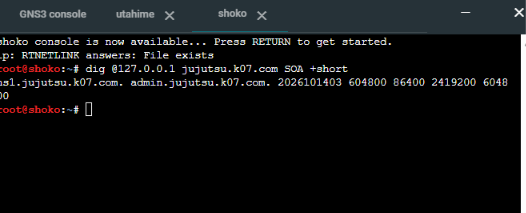


*Sebelum serial dinaikkan, shoko masih menampilkan serial lama `2026101403`. Setelah serial master dinaikkan menjadi `2026101404`, shoko otomatis menarik data baru dan menampilkan serial yang sama.*

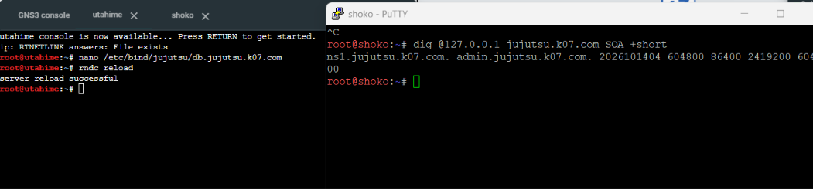 <br>

#### Bukti Client Bisa Query ke Master dan Slave (Itadori)

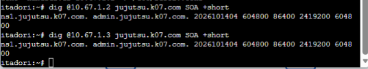

---

### 12. Konfigurasi Record DNS dan Forwarder

#### Soal
Peta domain harus memetakan pintu masuk utama dan tetap bisa mencari alamat di luar kawasan Shibuya. Pada utahime, buat A record `jujutsu.k07.com` yang mengarah ke gojo, serta CNAME `www` yang merujuk ke domain utama tersebut. Buat pula Reverse DNS (zona PTR) untuk melacak IP gojo kembali ke domain resminya, dan aktifkan fitur DNS Forwarder pada BIND9 mengarah ke IP gateway internet (192.168.122.1). Uji dari client dengan dig untuk mengecek CNAME, PTR, dan buktikan client tetap bisa melakukan ping ke domain internet seperti `google.com.`

#### Penjelasan & Konfigurasi

Pada `utahime`, zona forward ditambah A record `jujutsu` yang menunjuk ke IP `gojo` dan CNAME `www` yang merujuk ke `jujutsu.k07.com`. Zona reverse untuk Network 1 ditambahkan beserta PTR yang melacak IP `gojo` kembali ke domain resminya. Fitur forwarder diaktifkan pada `named.conf.options` dengan tujuan `192.168.122.1`, sehingga domain di luar zona (misalnya `google.com`) tetap bisa di-resolve. 

Seluruh perubahan disimpan di `12.sh`, dan serial zona dinaikkan agar shoko ikut menyinkronkan record baru.

**Pembaruan konfigurasi Utahime:**
```bash
cat > /root/12.sh << 'EOF'
#!/bin/bash
# 12.sh (utahime) - A, CNAME, PTR, forwarder

echo "nameserver 192.168.122.1" > /etc/resolv.conf

if ! command -v named >/dev/null 2>&1; then
    apt-get update
    apt-get install -y bind9 bind9utils dnsutils
fi

mkdir -p /etc/bind/jujutsu

cat > /etc/bind/named.conf.options << 'EOT'
options {
    directory "/var/cache/bind";
    listen-on { any; };
    allow-query { any; };
    recursion yes;
    allow-recursion { 10.67.0.0/16; 127.0.0.1; };
    forwarders { 192.168.122.1; };
    forward only;
    dnssec-validation no;
};
EOT

cat > /etc/bind/named.conf.local << 'EOT'
zone "jujutsu.k07.com" {
    type master;
    file "/etc/bind/jujutsu/db.jujutsu.k07.com";
    notify yes;
    allow-transfer { 10.67.1.3; };
    also-notify { 10.67.1.3; };
};

zone "1.67.10.in-addr.arpa" {
    type master;
    file "/etc/bind/jujutsu/db.10.67.1";
};
EOT

cat > /etc/bind/jujutsu/db.jujutsu.k07.com << 'EOT'
$TTL 604800
@   IN  SOA ns1.jujutsu.k07.com. admin.jujutsu.k07.com. (
            2026101403  ; serial
            604800      ; refresh
            86400       ; retry
            2419200     ; expire
            604800 )    ; negative cache
@   IN  NS  ns1.jujutsu.k07.com.
@   IN  NS  ns2.jujutsu.k07.com.
ns1 IN  A   10.67.1.2
ns2 IN  A   10.67.1.3
@   IN  A   10.67.1.4
www IN  CNAME jujutsu.k07.com.
EOT

cat > /etc/bind/jujutsu/db.10.67.1 << 'EOT'
$TTL 604800
@   IN  SOA ns1.jujutsu.k07.com. admin.jujutsu.k07.com. (
            2026101401  ; serial
            604800
            86400
            2419200
            604800 )
@   IN  NS  ns1.jujutsu.k07.com.
@   IN  NS  ns2.jujutsu.k07.com.
4   IN  PTR jujutsu.k07.com.
EOT

chown -R bind:bind /etc/bind/jujutsu 2>/dev/null

named-checkconf \
  && named-checkzone jujutsu.k07.com /etc/bind/jujutsu/db.jujutsu.k07.com \
  && named-checkzone 1.67.10.in-addr.arpa /etc/bind/jujutsu/db.10.67.1 \
  && (service named restart || service bind9 restart)
EOF
```
Pembaruan Konfigurasi ini memastikan bahwa domain utama dan subdomain dapat diakses, serta alamat IP gojo dapat dilacak kembali ke domain resminya melalui PTR record. Diberi juga forwarder memungkinkan resolusi nama domain eksternal tetap berfungsi.

**Pembaruan konfigurasi Shoko**

```bash
cat > /root/12.sh << 'EOF'
#!/bin/bash
# 12.sh (shoko) - DNS Slave jujutsu.k07.com + forwarder

echo "nameserver 192.168.122.1" > /etc/resolv.conf

if ! command -v named >/dev/null 2>&1; then
    apt-get update
    apt-get install -y bind9 bind9utils dnsutils
fi

mkdir -p /var/cache/bind/slaves
chown -R bind:bind /var/cache/bind/slaves 2>/dev/null

cat > /etc/bind/named.conf.options << 'EOT'
options {
    directory "/var/cache/bind";
    listen-on { any; };
    allow-query { any; };
    recursion yes;
    allow-recursion { 10.67.0.0/16; 127.0.0.1; };
    forwarders { 192.168.122.1; };
    forward only;
    dnssec-validation no;
};
EOT

cat > /etc/bind/named.conf.local << 'EOT'
zone "jujutsu.k07.com" {
    type slave;
    masters { 10.67.1.2; };
    file "/var/cache/bind/slaves/db.jujutsu.k07.com";
};
EOT

named-checkconf && (service named restart || service bind9 restart)
EOF

```

#### Hasil Pengujian

Pengujian dapat dilakukan 

```bash
dig @10.67.1.2 www.jujutsu.k07.com CNAME +short
dig @10.67.1.2 -x 10.67.1.4 +short
ping -c 2 google.com
```
#### Bukti Utahime Resolve CNAME dan PTR
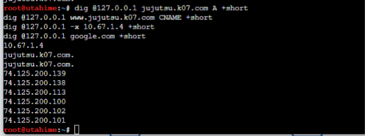

#### Bukti Client Resolve CNAME dan PTR
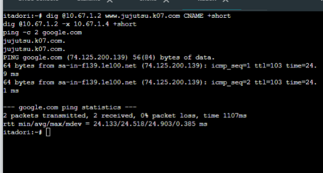

---

### 13. Replikasi Basis Data

#### Soal
Kepala Sekolah Yaga dan Inumaki mendirikan database terpusat yang redundan agar log aktivitas kutukan tetap aman tersimpan. Konfigurasikan MariaDB pada yaga sebagai DB-Master dan inumaki sebagai DB-Slave. Buat database `db_shibuya_k07` beserta tabel `request_logs` di Master, aktifkan binary logging (log-bin, server-id), lalu hubungkan inumaki sebagai Slave yang menyalin data secara realtime dengan `CHANGE MASTER TO.` Berikan hak akses remote bagi seluruh node di Network 4, lalu buktikan replikasi berhasil dengan memasukkan data baru di Master dan memeriksa hasilnya di Slave.

#### Penjelasan & Konfigurasi
Paket `mariadb-server` dipasang pada **yaga** (`10.67.4.8`) sebagai Master dan **inumaki** (`10.67.4.9`) sebagai Slave. Konfigurasi replikasi ditulis pada `/etc/mysql/mariadb.conf.d/99-replication.cnf`, yang dibaca setelah `50-server.cnf`, sehingga nilai `bind-address` bawaan (`127.0.0.1`) tertimpa dan server dapat menerima koneksi dari node lain.

##### Konfigurasi Master (yaga)

Pada Master, `log-bin` dan `server-id = 1` diaktifkan. Dibuat database `db_shibuya_K07` dengan tabel `request_logs`, user `repl` untuk replikasi, serta user `k07` dengan hak akses dari seluruh Network 4 (`10.67.4.%`).

```bash
# /etc/mysql/mariadb.conf.d/99-replication.cnf
[mysqld]
bind-address = 0.0.0.0
server-id    = 1
log-bin      = mysql-bin
binlog_format = ROW
```

```sql
CREATE DATABASE IF NOT EXISTS db_shibuya_K07;
USE db_shibuya_K07;
CREATE TABLE IF NOT EXISTS request_logs (
    id INT AUTO_INCREMENT PRIMARY KEY,
    worker VARCHAR(50),
    client_ip VARCHAR(45),
    path VARCHAR(255),
    created_at TIMESTAMP DEFAULT CURRENT_TIMESTAMP
);

CREATE USER IF NOT EXISTS 'repl'@'10.67.4.%' IDENTIFIED BY 'repl_k07';
GRANT REPLICATION SLAVE ON *.* TO 'repl'@'10.67.4.%';

CREATE USER IF NOT EXISTS 'k07'@'10.67.4.%' IDENTIFIED BY 'k07_pass';
GRANT ALL PRIVILEGES ON db_shibuya_K07.* TO 'k07'@'10.67.4.%';
FLUSH PRIVILEGES;
```
<br>

##### Konfigurasi Slave (inumaki)

 Pada Slave, `server-id = 2` dan koneksi ke Master dibuat dengan `CHANGE MASTER TO` memakai `MASTER_USE_GTID=slave_pos`, sehingga Slave tidak bergantung pada nama file dan posisi binlog yang berubah setiap Master dijalankan ulang.

```bash
# /etc/mysql/mariadb.conf.d/99-replication.cnf
[mysqld]
bind-address = 0.0.0.0
server-id    = 2
log-bin      = mysql-bin
relay-log    = relay-bin
read_only    = 1
```

```sql
CHANGE MASTER TO
    MASTER_HOST='10.67.4.8',
    MASTER_USER='repl',
    MASTER_PASSWORD='repl_k07',
    MASTER_USE_GTID=slave_pos;
START SLAVE;
```
#### Hasil Pengujian
Pengujian dapat dilakukan dengan beberapa command dibawah ini:

```bash
#yaga
mariadb -e "SHOW MASTER STATUS;"
mariadb -e "INSERT INTO db_shibuya_K07.request_logs (worker,client_ip,path) VALUES ('test','0.0.0.0','/demo');"
```
```bash
#inumaki
mariadb -e "SHOW SLAVE STATUS\G" | grep -E "Running|Error|Behind"
mariadb -e "SELECT * FROM db_shibuya_K07.request_logs WHERE worker='test';"
mariadb -h 10.67.4.8 -u k07 -pk07_pass -e "SELECT CURRENT_USER(), @@hostname;"
```

##### Bukti Slave Berjalan dan Master Aktif
`Slave_IO_Running` dan `Slave_SQL_Running` bernilai `Yes`

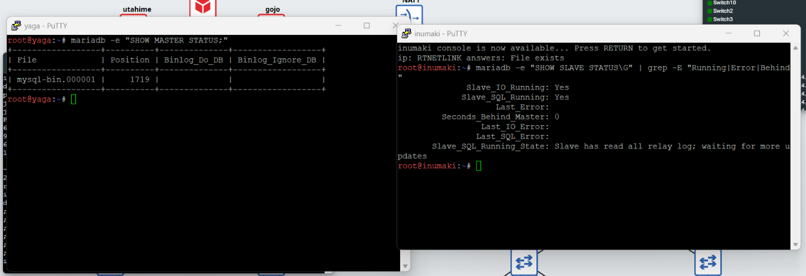

##### Bukti Replikasi Data
*Data dimasukkan pada yaga, lalu muncul pada inumaki tanpa perubahan apa pun di sisi Slave.*

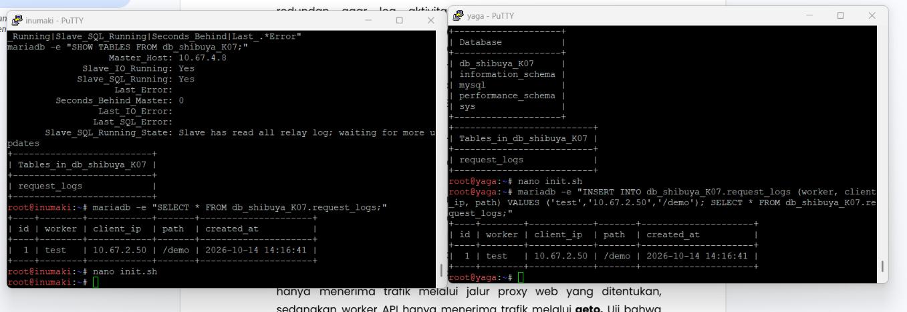

##### Bukti Hak Akses Remote dari Node Network 4
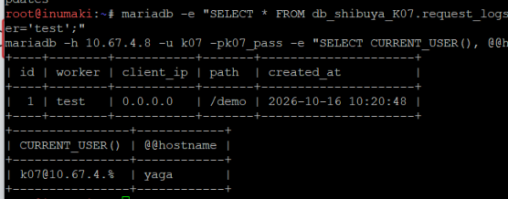

---

### 14. Konfigurasi Worker Web dan API

#### Soal
Para penyihir lapangan bersiaga di Data Center sebagai pekerja backend untuk memproses aplikasi. Pasang `Nginx` dan `PHP-FPM `pada maki dan panda untuk menyajikan web frontend yang menampilkan hostname masing-masing. Pada nanami, todo, dan kirara, siapkan layanan API yang mencatat log request ke database yaga. Konfigurasikan virtual host agar worker merespons domain layanan yang ditentukan. Batasi akses langsung dari klien ke worker, web worker hanya menerima trafik melalui jalur proxy web yang ditentukan, sedangkan worker API hanya menerima trafik melalui geto. Uji bahwa akses langsung dari klien ditolak, sementara akses melalui reverse proxy tetap berhasil.

#### Penjelasan & Konfigurasi
Seluruh worker memakai Nginx dan PHP 8.4 (`php8.4-fpm`) pada Debian, dengan socket `/run/php/php8.4-fpm.sock`.

##### Konfigurasi Virtual Host Frontend (maki dan panda)

Skrip PHP menampilkan hostname node. Virtual host merespons `jujutsu.k07.com` dan `www.jujutsu.k07.com`, dan hanya mengizinkan koneksi dari gojo (`10.67.1.4`) serta localhost untuk pengujian. Koneksi dari alamat lain ditolak dengan `403 Forbidden`.

```bash
# /var/www/jujutsu/index.php
<?php
header('Content-Type: text/plain');
echo "Frontend: " . gethostname() . "\n";
```

```bash
# /etc/nginx/sites-available/jujutsu
server {
    listen 80;
    server_name jujutsu.k07.com www.jujutsu.k07.com;
    root /var/www/jujutsu;
    index index.php;

    # Hanya reverse proxy gojo (dan localhost untuk tes)
    allow 10.67.1.4;
    allow 127.0.0.1;
    deny all;

    location / {
        try_files $uri $uri/ =404;
    }

    location ~ \.php$ {
        include snippets/fastcgi-php.conf;
        fastcgi_pass unix:/run/php/php8.4-fpm.sock;
    }
}
```

##### Konfigurasi API (nanami, todo, dan kirara)

Endpoint `/api` dijalankan oleh `api.php`, yang menghubungkan ke yaga (`10.67.4.8`) dengan user `k07` melalui paket `php-mysql`, lalu menyimpan satu baris ke `request_logs` dan mengembalikan nama worker dalam format JSON. Virtual host hanya mengizinkan geto (`10.67.4.2`) dan localhost. Direktif `default_server` dipasang agar virtual host tetap menjawab apa pun nilai header `Host` yang diteruskan geto.

```bash
# /var/www/api/api.php
<?php
header('Content-Type: application/json');
mysqli_report(MYSQLI_REPORT_OFF);
$worker = gethostname();
$db = @new mysqli('10.67.4.8', 'k07', 'k07_pass', 'db_shibuya_K07');
if ($db->connect_errno) {
    http_response_code(500);
    echo json_encode(['worker' => $worker, 'logged' => false, 'error' => 'db connect failed']);
    exit;
}
$ip   = $_SERVER['REMOTE_ADDR'];
$path = $_SERVER['REQUEST_URI'];
$st = $db->prepare('INSERT INTO request_logs (worker, client_ip, path) VALUES (?, ?, ?)');
$st->bind_param('sss', $worker, $ip, $path);
$ok = $st->execute();
echo json_encode(['worker' => $worker, 'logged' => $ok]);
```
```bash
# /etc/nginx/sites-available/jujutsu-api
server {
    listen 80 default_server;
    server_name jujutsu.k07.com www.jujutsu.k07.com;

    # Hanya geto (dan localhost untuk tes)
    allow 10.67.4.2;
    allow 127.0.0.1;
    deny all;

    location /api {
        include fastcgi_params;
        fastcgi_param SCRIPT_FILENAME /var/www/api/api.php;
        fastcgi_pass unix:/run/php/php8.4-fpm.sock;
    }
}
```
Ketiga worker API memakai script yang sama persis. Nama worker dibedakan oleh `gethostname()`.

#### Hasil Pengujian
Beberapa pengujian dapat dilakukan dengan menjalankan:

```bash
#maki
curl -s -H "Host: jujutsu.k07.com" http://127.0.0.1/

tail -5 /var/log/nginx/access.log

#nanami
curl -s http://127.0.0.1/api
```
```bash
#client
wget -S -O- -T 5 http://10.67.4.3/
```
##### Bukti Web Frontend Menampilkan Hostname
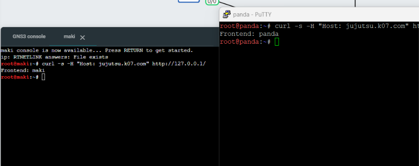

##### Bukti API Mencatat Log
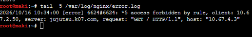

##### Bukti Akses Langsung dari Client Ditolak
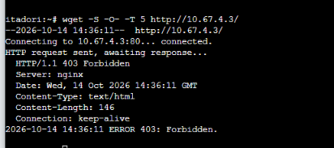

##### Bukti Akses Melalui Reverse Proxy Berhasil
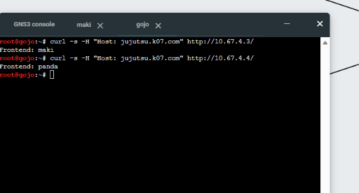

---

### 15. Konfigurasi Load Balancer Internal

#### Soal
Geto bertugas mengendalikan pembagian beban request API di internal Data Center agar server tidak tumbang bersamaan. Konfigurasikan Nginx pada geto sebagai Load Balancer internal dengan upstream `api_cluster` yang mengarahkan trafik ke nanami dan todo. Terapkan algoritma Weighted Round Robin dengan bobot 3:1, di mana nanami menerima porsi beban tiga kali lebih banyak daripada todo. Buktikan distribusi beban ini dengan melakukan loop request berulang kali ke geto dari jaringan lokal Data Center dan periksa rasio responnya.

#### Penjelasan & Konfigurasi
Nginx dipasang pada **geto** (`10.67.4.2`) dan dikonfigurasi dengan upstream `api_cluster` yang berisi nanami (`10.67.4.5`) dengan `weight=3` dan todo (`10.67.4.6`) dengan `weight=1`. Dengan bobot tersebut, dari setiap empat request tiga diteruskan ke nanami dan satu ke todo. Request pada path `/api` diteruskan ke upstream dengan header `Host` yang dipertahankan.

##### Konfigurasi Load Balancer (`/etc/nginx/conf.d/api-lb.conf` pada geto)
```bash
upstream api_cluster {
    server 10.67.4.5 weight=3;   # nanami
    server 10.67.4.6 weight=1;   # todo
}

server {
    listen 80 default_server;
    server_name _;

    location /api {
        proxy_pass http://api_cluster;
        proxy_set_header Host $host;
    }
}
```

```bash
nginx -t
service nginx restart
```

#### Bukti Distribusi Beban dari Jaringan Data Center
Loop 40 request dari maki ke geto, lalu dihitung per worker.

```bash
for i in $(seq 1 40); do curl -s http://10.67.4.2/api; echo; done | grep -o '"worker":"[a-z]*"' | sort | uniq -c
```

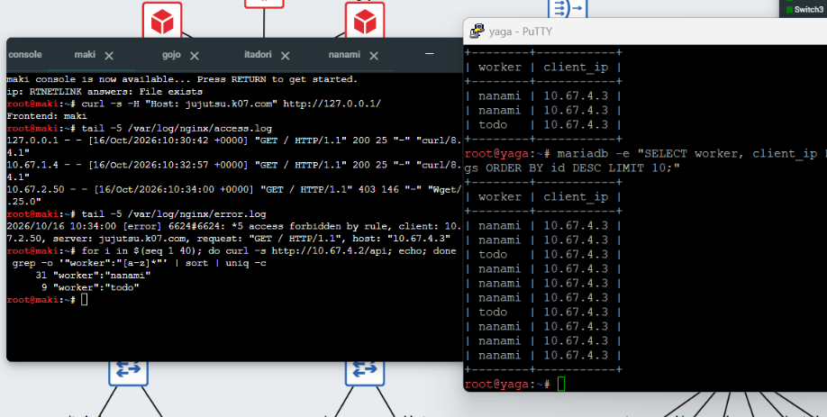

Hasil yang diperoleh adalah 31 respons dari nanami dan 9 dari todo, mendekati rasio 3:1. Selisih dari 30:10 terjadi karena Nginx menjalankan beberapa worker process, dan setiap process menghitung giliran round robin-nya sendiri. 

---

### 16. Konfigurasi Reverse Proxy Publik

#### Soal
Gojo berdiri di perbatasan DMZ sebagai gerbang publik tunggal bagi seluruh client dari luar maupun dalam. Konfigurasikan Nginx pada gojo untuk melayani domain `jujutsu.<xxxx>.com` dan `www.jujutsu.<xxxx>.com` menggunakan metode Path-Based Routing. Atur agar request root (`/`) diteruskan secara Round Robin ke worker frontend (maki dan panda), sedangkan request ke path `/api` diteruskan langsung ke geto. Uji dari client Divisi A atau B bahwa akses ke web utama dibalas oleh Maki/Panda, sedangkan akses ke `/api` diteruskan dan dijawab oleh Nanami/Todo.

#### Penjelasan & Konfigurasi
Nginx dipasang pada **gojo** (`10.67.1.4`) dengan satu virtual host untuk `jujutsu.k07.com` dan `www.jujutsu.k07.com`. Routing dilakukan berdasarkan path:

- `location /` diteruskan ke upstream `frontend` yang berisi maki (`10.67.4.3`) dan panda (`10.67.4.4`). Tanpa direktif tambahan, Nginx memakai algoritma Round Robin.
- `location /api` diteruskan ke geto (`10.67.4.2`), yang kemudian membagi beban ke nanami dan todo.

Header `Host` dipertahankan agar virtual host pada worker menerima nama domain yang sama.

##### Konfigurasi Reverse Proxy (`/etc/nginx/conf.d/gojo.conf` pada gojo)
```bash
upstream frontend {
    server 10.67.4.3;   # maki
    server 10.67.4.4;   # panda
}

server {
    listen 80;
    server_name jujutsu.k07.com www.jujutsu.k07.com;

    location /api {
        proxy_pass http://10.67.4.2;
        proxy_set_header Host $host;
    }

    location / {
        proxy_pass http://frontend;
        proxy_set_header Host $host;
    }
}
```

```bash
nginx -t
service nginx restart
```


#### Hasil Pengujian

```bash
for i in 1 2 3 4; do wget -qO- "http://jujutsu.k07.com/?u=$i-$(date +%s)"; done

for i in 1 2 3 4 5 6 7 8; do wget -S -O- -T 5 http://www.jujutsu.k07.com/api 2>&1 | grep -E "HTTP/|worker"; sleep 0.2; done
```
#### Bukti Akses Web Utama Dibalas Maki dan Panda
Dari client, request ke `/` dijawab bergantian oleh maki dan panda.

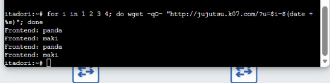

#### Bukti Akses `/api` Dijawab Nanami dan Todo
Request ke `/api` melalui `www.jujutsu.k07.com` diteruskan ke geto dan dijawab nanami serta todo dengan pola 3:1.


#### Bukti Trafik Melewati Gojo & Geto
Pada access log maki dan panda, alamat sumber request adalah `10.67.1.4` (gojo) dan `10.67.4.2` (geto), bukan alamat client.


---

### 17. Penerusan Alamat IP Klien

#### Soal
Komando pusat perlu mengetahui IP asli klien yang mengirimkan request tanpa tertukar dengan IP proxy perantara. Konfigurasikan gojo dan geto agar meneruskan informasi alamat klien melalui header `X-Real-IP` dan `X-Forwarded-For`. Pastikan geto hanya mempercayai informasi alamat klien yang diterima dari proxy terpercaya, dan skrip API menyimpan alamat klien yang telah diverifikasi ke kolom `client_ip` pada tabel `request_logs` di database yaga. Uji dengan mengirimkan request dari klien Network 2 dan Network 3 ke endpoint `/api`, kemudian periksa database untuk memastikan alamat yang tercatat sesuai dengan IP klien asal, bukan IP gojo atau geto.

#### Penjelasan & Konfigurasi
Alur request `/api` adalah client → gojo → geto → worker API, sehingga tanpa penanganan khusus worker hanya melihat alamat geto. Penerusan alamat dilakukan pada tiga tempat.

##### 1. Konfigurasi gojo (`/etc/nginx/conf.d/gojo.conf`, bagian `/api`)

Pada `location /api`, `X-Real-IP` diisi `$remote_addr` (alamat client yang terhubung ke gojo), dan `X-Forwarded-For` diisi `$proxy_add_x_forwarded_for`, yaitu nilai header lama yang ditambah alamat client di bagian belakang.

```bash
location /api {
    proxy_pass http://10.67.4.2;
    proxy_set_header Host $host;
    proxy_set_header X-Real-IP $remote_addr;
    proxy_set_header X-Forwarded-For $proxy_add_x_forwarded_for;
}
```

##### 2. Konfigurasi geto (`/etc/nginx/conf.d/api-lb.conf`)

 Modul `realip` hanya mempercayai header`X-Forwarded-For` bila koneksi berasal dari gojo (`set_real_ip_from 10.67.1.4`). Koneksi dari alamat lain tidak dipercaya, dan alamat koneksi langsunglah yang dipakai. Dengan `real_ip_recursive off`, Nginx memakai alamat **terakhir** pada `X-Forwarded-For`, yaitu alamat yang ditambahkan gojo, sehingga nilai palsu yang dikirim client di bagian depan header diabaikan. Setelah itu geto meneruskan `X-Real-IP $remote_addr` ke worker.

```bash
upstream api_cluster {
    server 10.67.4.5 weight=3;   # nanami
    server 10.67.4.6 weight=1;   # todo
}

server {
    listen 80 default_server;
    server_name _;

    # Percaya header X-Forwarded-For hanya kalau koneksi datang dari gojo
    set_real_ip_from 10.67.1.4;
    real_ip_header X-Forwarded-For;
    real_ip_recursive off;

    location /api {
        proxy_pass http://api_cluster;
        proxy_set_header Host $host;
        proxy_set_header X-Real-IP $remote_addr;
        proxy_set_header X-Forwarded-For $proxy_add_x_forwarded_for;
    }
}
```

##### 3. Konfigurasi API (`/var/www/api/api.php` pada nanami, todo, dan kirara)

`api.php` hanya membaca `X-Real-IP` bila koneksi langsung berasal dari geto (`10.67.4.2`) dan nilainya lolos validasi `FILTER_VALIDATE_IP`. Selain itu, yang dicatat adalah `REMOTE_ADDR`. Lapisan pertama tetap virtual host worker, yang menolak koneksi selain dari geto sehingga header palsu dari client tidak pernah sampai ke PHP.

```bash
<?php
header('Content-Type: application/json');
mysqli_report(MYSQLI_REPORT_OFF);
$worker = gethostname();
$db = @new mysqli('10.67.4.8', 'k07', 'k07_pass', 'db_shibuya_K07');
if ($db->connect_errno) {
    http_response_code(500);
    echo json_encode(['worker' => $worker, 'logged' => false, 'error' => 'db connect failed']);
    exit;
}
$ip = $_SERVER['REMOTE_ADDR'];
if ($ip === '10.67.4.2' && !empty($_SERVER['HTTP_X_REAL_IP'])
    && filter_var($_SERVER['HTTP_X_REAL_IP'], FILTER_VALIDATE_IP)) {
    $ip = $_SERVER['HTTP_X_REAL_IP'];
}
$path = $_SERVER['REQUEST_URI'];
$st = $db->prepare('INSERT INTO request_logs (worker, client_ip, path) VALUES (?, ?, ?)');
$st->bind_param('sss', $worker, $ip, $path);
$ok = $st->execute();
echo json_encode(['worker' => $worker, 'logged' => $ok]);
```


#### Hasil Pengujian
```bash
for i in 1 2 3 4 5 6 7 8; do wget -qO- -T 5 http://jujutsu.k07.com/api; echo; sleep 1; done

wget -qO- -T 5 --header="X-Forwarded-For: 1.2.3.4" http://jujutsu.k07.com/api; echo
```

#### Bukti Request dari Client Network 2
Request ke `/api` dikirim dari itadori, lalu isi `request_logs` diperiksa pada yaga. Kolom `client_ip` berisi `10.67.2.50`, yaitu alamat client, bukan gojo (`10.67.1.4`) maupun geto (`10.67.4.2`).


#### Bukti Request dari Client Network 3
Request yang sama dikirim dari kusakabe. Kolom `client_ip` berisi `10.67.3.50`. Client juga mengirim `X-Forwarded-For: 1.2.3.4`. Alamat yang tercatat tetap alamat client yang sebenarnya, bukan `1.2.3.4`.


---

### 18. Worker Cadangan dan Health Check

#### Soal
Nanami dan todo merupakan worker API utama, sedangkan kirara disiapkan sebagai worker cadangan. Konfigurasikan upstream `api_cluster` pada geto agar kirara menjadi server backup, serta terapkan passive health check dengan parameter `max_fails=2` dan `fail_timeout=5s` pada worker API utama. Pastikan kirara menjalankan layanan API yang kompatibel dengan endpoint utama. Simulasikan gangguan dengan menghentikan layanan Nginx atau layanan API pada nanami dan todo. Buktikan dari klien bahwa request ke `/api` dialihkan ke kirara dan menghasilkan respons API yang valid tanpa error 502 Bad Gateway.

#### Penjelasan & Konfigurasi
Pada upstream `api_cluster` di **geto**, kirara (`10.67.4.7`) ditandai `backup`, sehingga hanya menerima request bila seluruh server utama tidak tersedia. Nanami dan todo diberi `max_fails=2` dan `fail_timeout=5s`: bila dua percobaan berturut-turut gagal, server ditandai tidak tersedia selama 5 detik sebelum dicoba lagi (passive health check).

##### Konfigurasi geto (`/etc/nginx/conf.d/api-lb.conf`)
```bash
upstream api_cluster {
    server 10.67.4.5 weight=3 max_fails=2 fail_timeout=5s;   # nanami
    server 10.67.4.6 weight=1 max_fails=2 fail_timeout=5s;   # todo
    server 10.67.4.7 backup;                                 # kirara
}

server {
    listen 80 default_server;
    server_name _;

    set_real_ip_from 10.67.1.4;
    real_ip_header X-Forwarded-For;
    real_ip_recursive off;

    location /api {
        proxy_pass http://api_cluster;
        proxy_set_header Host $host;
        proxy_set_header X-Real-IP $remote_addr;
        proxy_set_header X-Forwarded-For $proxy_add_x_forwarded_for;
        proxy_next_upstream error timeout http_502 http_503 http_504;
        proxy_connect_timeout 2s;
    }
}
```
Direktif `proxy_next_upstream` dan `proxy_connect_timeout 2s` ditambahkan agar request yang gagal pada server utama langsung diulang ke server berikutnya, sehingga client tidak menerima 502 pada request yang kebetulan mengenai server yang baru saja mati.

Kirara memakai `api.php` dan virtual host yang sama dengan nanami dan todo, sehingga responsnya kompatibel dengan endpoint utama. Nama worker dibedakan oleh `gethostname()`.

```bash
nginx -t
service nginx restart
```
#### Hasil Pengujian
```bash
for i in 1 2 3 4 5 6 7 8; do wget -qO- -T 5 http://jujutsu.k07.com/api; echo; sleep 1; done
```
<br>

##### Bukti Kirara Tidak Menerima Trafik Saat Worker Utama Hidup
Sebelum gangguan, request hanya dijawab nanami dan todo.


##### Bukti Pengalihan ke Kirara Saat Nanami dan Todo Dihentikan
Nginx pada nanami dan todo dihentikan dengan `service nginx stop`. Seluruh request dari client menghasilkan `200 OK` dengan worker `kirara`, tanpa 502.


---

### 19. Proxy Caching dan Rate Limiting

#### Soal
Gojo bertugas mengoptimalkan layanan web sekaligus membatasi request berlebihan. Konfigurasikan Nginx Proxy Caching untuk halaman web frontend dengan masa berlaku cache 10 menit dan tambahkan header `X-Cache-Status`. Terapkan rate limiting pada path `/api` dengan batas 10 request per detik per IP klien. Buktikan bahwa request ke halaman web yang memenuhi syarat cache menghasilkan status `MISS` pada akses awal dan `HIT` pada akses berikutnya. Uji rate limiting secara terpisah dengan mengirimkan request beruntun ke `/api`, kemudian catat status respons yang dihasilkan ketika batas terlampaui.

#### Penjelasan & Konfigurasi

##### Konfigurasi gojo (`/etc/nginx/conf.d/gojo.conf`)

Zona cache `web_cache` dibuat dengan `proxy_cache_path`. Pada `location /`, respons `200` disimpan selama 10 menit (`proxy_cache_valid 200 10m`), dan header `X-Cache-Status` diisi `$upstream_cache_status`, yang bernilai `MISS` saat respons diambil dari worker dan `HIT` saat dilayani dari cache gojo.

```bash
proxy_cache_path /var/cache/nginx/jujutsu levels=1:2 keys_zone=web_cache:10m max_size=100m inactive=10m;
limit_req_zone $binary_remote_addr zone=api_limit:10m rate=10r/s;

upstream frontend {
    server 10.67.4.3;   # maki
    server 10.67.4.4;   # panda
}
```
Zona `api_limit` membatasi 10 request per detik per alamat client (`$binary_remote_addr`) dan dipasang pada `location /api`. Tanpa parameter `burst`, request yang melebihi batas langsung ditolak dengan status `503`.

```bash
server {
    listen 80;
    server_name jujutsu.k07.com www.jujutsu.k07.com;

    location /api {
        limit_req zone=api_limit;
        proxy_pass http://10.67.4.2;
        proxy_set_header Host $host;
        proxy_set_header X-Real-IP $remote_addr;
        proxy_set_header X-Forwarded-For $proxy_add_x_forwarded_for;
    }

    location / {
        proxy_cache web_cache;
        proxy_cache_valid 200 10m;
        add_header X-Cache-Status $upstream_cache_status;
        proxy_pass http://frontend;
        proxy_set_header Host $host;
    }
}
```

Selama cache berlaku, request `/` yang berstatus `HIT` dijawab gojo sendiri, sehingga maki atau panda yang sama akan terus muncul.

```bash
nginx -t
service nginx restart
```

#### Hasil Pengujian
```bash
for i in 1 2 3; do wget -S -O /dev/null -T 5 http://jujutsu.k07.com/ 2>&1 | grep -i "X-Cache-Status"; done

for i in $(seq 1 30); do wget -S -O /dev/null -T 5 http://jujutsu.k07.com/api 2>&1 | grep -E "HTTP/"; done | sort | uniq -c
```
#### Bukti Rate Limit & Cache `MISS` lalu `HIT`
Tiga request berturut-turut ke halaman yang sama menghasilkan `MISS`, `HIT`, `HIT`. 


Tiga puluh request paralel dikirim ke `/api`. Sebagian kecil berhasil (`200 OK`), sedangkan sisanya ditolak dengan `503 Service Unavailable` karena melampaui batas 10 request per detik.

#### Bukti Penolakan pada Error Log Gojo
Setiap penolakan tercatat pada `error.log` dengan pesan `limiting requests`.


---

### 20. Pengujian Kinerja dengan Apache Benchmark

#### Soal
Sebelum Curtain di Shibuya resmi dibuka, Kusakabe memimpin audit untuk menguji kapasitas layanan. Dari terminal kusakabe, jalankan benchmark menggunakan Apache Benchmark dengan parameter `-n 600 -c 30` menuju `http://jujutsu.<xxxx>.com/`. Catat Requests per Second (RPS), latensi, dan jumlah request yang gagal. Lakukan pengujian tambahan pada endpoint `/api` untuk mengamati efek rate limiting. Bandingkan hasil pengujian baseline dengan hasil ketika rate limiting aktif, serta gunakan access log gojo untuk membedakan kegagalan aplikasi, koneksi, dan request yang ditolak oleh kebijakan rate limit.

#### Penjelasan & Pengujian
Apache Benchmark (`ab`) dipasang pada **kusakabe** dengan paket `apache2-utils`. Pengujian dijalankan sebanyak tiga kali dengan 600 request dan 30 koneksi bersamaan. Access log dan error log gojo dikosongkan sebelum pengujian agar jumlah status pada log dapat dicocokkan dengan hasil `ab`.

```bash
ab -n 600 -c 30 http://jujutsu.k07.com/
ab -n 600 -c 30 http://jujutsu.k07.com/api
```

Pembanding tanpa rate limit diperoleh dengan menonaktifkan sementara baris `limit_req zone=api_limit;` pada gojo, lalu mengaktifkannya kembali setelah pengujian.

##### Hasil Pengujian

| Pengujian | RPS | Latensi rata-rata | Failed requests | Keterangan |
|---|---|---|---|---|
| `/api` (rate limit aktif) | 5354,08 | 5,603 ms | 598 | 598 Non-2xx, seluruhnya `503` |
| `/api` (rate limit nonaktif) | 815,68 | 36,779 ms | 149 | Seluruh status `200`, tipe kegagalan `Length` |

##### Pembacaan Hasil

- **`/api` dengan rate limit aktif.** Hanya 2 dari 600 request diteruskan, 598 ditolak. RPS tetap tinggi karena `503` dijawab gojo sendiri tanpa melewati geto, worker, PHP, dan database.

- **`/api` tanpa rate limit.** Setiap request melewati gojo, geto, worker, PHP, dan penulisan ke yaga, sehingga RPS turun sekitar enam kali lipat dan latensi naik dari sekitar 5,6 ms menjadi sekitar 36,8 ms.

- **Failed requests tipe `Length`.** Kegagalan ini berasal dari `ab` menandai respons yang panjang body-nya berbeda dari respons pertama sebagai gagal walaupun statusnya `200`. Body `nanami` dan `todo` berbeda panjang satu byte.

Bisa juga meng-ignore length dengan menambahkan `-l`.

##### Pembedaan Jenis Kegagalan dengan Access Log Gojo 

```bash
awk '{print $9}' /var/log/nginx/access.log | sort | uniq -c
grep -c "limiting requests" /var/log/nginx/error.log
```

| Kondisi | Status pada access log | Baris `limiting requests` | Kesimpulan |
|---|---|---|---|
| Rate limit aktif | 598 x `503`, sisanya `200` | 598 | Seluruh penolakan berasal dari kebijakan rate limit |
| Rate limit nonaktif | 600 x `200` | 0 | Tidak ada penolakan |


#### Bukti Hasil Benchmark

##### Bukti Berhasil Mengirim Cache


##### Bukti Failed Request With Limit


##### Bukti Request With No Limit
*149 disini hanya error length.*


#### Bukti Rekap Status pada Access Log Gojo

##### Dengan Limit


##### Limitless


---